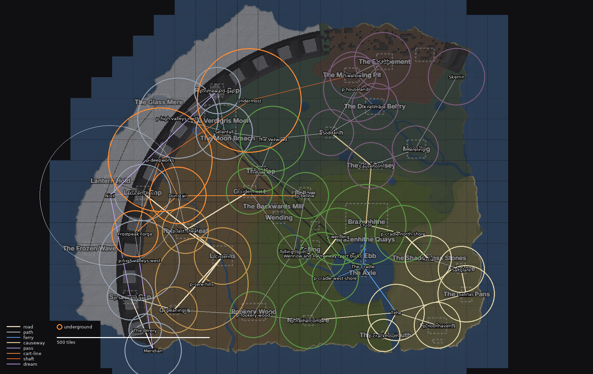

# The area plan: pass 1, the skeleton

Generated from `skeleton.json` by `tools/areas/plan.py`. Edit the JSON, not this file.

**Scale:** 1.75 tiles per sketch pixel; a region is 96 × 96 tiles. Sizes are in regions and rough. Positions are on the sketch; Tolling stays at tile (0, 0).

## Checks

| Check | Status | Result |
| --- | --- | --- |
| I-REACH | ok | every area reachable from Tolling |
| I-NAMES | ok | every name in world-map.md placed once |
| size | info | areas cover 124 regions = 1.14M tiles of surface; the sketch's land at 1.75 tiles/px is 1.18M tiles (97%) |
| T-UNDER | outside | underground outside Candora / surface: 0.01 (range 0.30-0.60); with Candora and Undermost: 0.25 |
| T-LADDER | outside | 4 cities, 4 towns, 8 villages, 9 hamlets: 0.41 towns and 0.82 villages per 100k land tiles (ranges [0.5, 1.5], [1.5, 4.0]) |
| T-LAND-BUILT | outside | estimated from settlement tiers: 9% (range 10%-20%) |
| T-CITY-DOMINANCE | ok | pass 1 measures size only: cruor 6 regions against tithe 3: 2.0 (range 1.5-3.0) |
| T-LAND-SPARSE | later | needs content (pass 2 onwards) |

## Venaria

| Area | Parts | Size | Links | Notes |
| --- | --- | --- | --- | --- |
| **Tolling (built)** | Tolling (town); Widdermill; Sour Hollow; The sleepers' graves | 1 | Wennow and Palmerway (road), p-cidermoot (path), p-rookery-wood (path), p-bellow (path) | Built: tiles 0-95, 0-95. Positions in this plan follow docs/world-map.md over the sketch where they disagree. |
| **Wennow and Palmerway (part built)** | Wennow; Palmerway; The waystone; The old toll-house (hamlet); The wardens' palisade and waygate | 2 | Tolling (road), p-wending (road), p-cradle-west-shore (path) | Built: tiles 96-191, 0-95 (the road and Wennow's north shore). |
| **p-wending** | p-wending (village); p-wending river crossing; river farms (hamlet) | 3 | Wennow and Palmerway (road), Cruor (road), p-bellow (path) |  |
| **Cruor** | p-quays (the Brazenhithe Quays on the sketch); The Synod's close; p-markets; p-old-town; p-barracks; p-outer-wards; Cruor (city); p-catacombs and the martyrs' crypts [underground] | 6 | p-wending (road), The Cradle (ferry), Causeholm (causeway), p-cradle-north-shore (road) | The one very large city: about twice the next city in what it holds. Its districts get their content in pass 2. |
| **p-cradle-north-shore** | fishing villages (village) | 3 | Cruor (road), Ascia (road) |  |
| **p-cradle-west-shore** | fishing hamlets (hamlet) | 2 | Wennow and Palmerway (path), p-nethercombe (path), The Cradle (ferry) |  |
| **p-nethercombe** | p-nethercombe (village) | 3 | p-cradle-west-shore (path), p-rookery-wood (path), Tithe (road) |  |
| **p-bellow** | p-bellow (village) | 2 | Tolling (path), p-wending (path), p-snap (path), Dunstair (cart-line) |  |
| **p-cidermoot** | p-cidermoot (village); orchards and presses | 2 | Tolling (path), p-snap (path), p-last-sheaf (road) |  |
| **p-rookery-wood** | p-rookery-wood | 2 | Tolling (path), p-nethercombe (path), p-gleanings (path) |  |
| **p-snap** | the scar: a ravine left by a moonfall; its edges (moonbark, moonmoss) | 2 | p-cidermoot (path), p-bellow (path), The Veilwood (path), Selenfall (path) |  |
| **The Veilwood** | the edges; the deep; the heart; the Dreamweaver's archive; ways into the Dreaming | 4 | p-snap (path), Selenfall (path), Sodden (path), The Dreaming (dream) | Location proposed in pass 1 (no doc placed it): beside Selenfall and the moonfall scar, since moonbark grows on old moonfall scars. |

## The Dreaming

| Area | Parts | Size | Links | Notes |
| --- | --- | --- | --- | --- |
| **The Dreaming [dreaming]** | memory orbs; the nightmare's rotations | - | The Veilwood (dream) | A realm apart from the continent, entered from the Veilwood. Not on the map; its size and shape are decided later. |

## The Cradle

| Area | Parts | Size | Links | Notes |
| --- | --- | --- | --- | --- |
| **The Cradle [water]** | the ferries; p-ebb; p-axle; the hushfin waters [during the Cradle's event]; The Quaere (the Responsory) | - | Cruor (ferry), Tithe (ferry), p-cradle-west-shore (ferry) |  |

## Calcinia

| Area | Parts | Size | Links | Notes |
| --- | --- | --- | --- | --- |
| **Tithe** | Tithe (city); the towers over the channel; the customs and counting houses; the see's cathedral; the harbour | 3 | The Cradle (ferry), p-crackmouth (road), Salinas (road), p-nethercombe (road), p-noonhaven (road) |  |
| **p-crackmouth** | the channel to the open sea | 1 | Tithe (road) |  |
| **Salinas** | the salt pans; the salt works (hamlet) | 3 | Tithe (road), Saltglare (road) |  |
| **Saltglare** | Saltglare (town) | 2 | Salinas (road), Ascia (path) |  |
| **Ascia** | the shadowless stones | 2 | Saltglare (path), p-cradle-north-shore (road) |  |
| **p-noonhaven** | p-noonhaven (village) | 2 | Tithe (road) |  |

## Sere

| Area | Parts | Size | Links | Notes |
| --- | --- | --- | --- | --- |
| **Cistern** | Cistern (city); the deep wells; the caravan markets; Queen Saffiya's palace | 3 | p-last-sheaf (road), p-sere-hills (road), Lucern Pass (road), p-gleanings (road) |  |
| **p-last-sheaf** | the last farms before the dry country (hamlet) | 2 | p-cidermoot (road), Cistern (road), Dunstair (path) |  |
| **p-gleanings** | p-gleanings (village) | 2 | Cistern (road), p-rookery-wood (path), p-saltward-gap (road) |  |
| **p-sere-hills** | dry hills, wells and cinnabar workings | 8 | Cistern (road) |  |

## Slough

| Area | Parts | Size | Links | Notes |
| --- | --- | --- | --- | --- |
| **Causeholm** | the old causeway; Causeholm (hamlet) | 2 | Cruor (causeway), Sodden (causeway), Mereling (path) |  |
| **Sodden** | Sodden (town) | 2 | Causeholm (causeway), Knellmere (path), The Veilwood (path), p-houselands (path) |  |
| **Knellmere** | the drowned belfry | 2 | Sodden (path), p-houselands (path) |  |
| **Mereling** | Mereling (village) | 2 | Causeholm (path), Skerrin (path) |  |
| **p-houselands** | the seat of Gall; the seat of Umber; the seat of Mordant; Sallow's ruined seat | 4 | Sodden (path), Knellmere (path), Scalth (path) | The four occult houses' estates; whether they share an area or spread across Slough is open. |
| **Scalth** | the burning ground | 3 | p-houselands (path), Swallow (path) | "The Escapement" on the sketch. |
| **Swallow** | the sinkhole | 2 | Scalth (path), Undermost (shaft) | "The Mainspring Pit" on the sketch. |
| **Skerrin** | the sea stacks; the sea caves [underground] | 3 | Mereling (path) |  |

## Candora

| Area | Parts | Size | Links | Notes |
| --- | --- | --- | --- | --- |
| **Meridian** | Meridian (city) | 3 | p-saltward-gap (road), The Orrery (path), p-high-valleys-west (pass) | Where the range comes down to the sea, at its south-western end. |
| **The Orrery** | the observatory (hamlet) | 1 | Meridian (path) |  |
| **p-saltward-gap** | the southern pass | 2 | p-gleanings (road), Meridian (road), Nivil (pass) |  |
| **Lucern Pass** | the beacon towers (hamlet); p-lantern-hold (the Nivil end) (hamlet) | 3 | Cistern (road), Nivil (pass), p-high-valleys-west (path), p-high-valleys-north (path) | "Lantern Gap" and "Lantern Hold" on the sketch. |
| **p-high-valleys-west** | high valleys and pale-pine forests | 6 | Lucern Pass (path), Meridian (pass), Frostpeak Forge (path) |  |
| **p-high-valleys-north** | high valleys and pale-pine forests | 6 | Lucern Pass (path), Selenfall (path), p-rimeward-gap (path) |  |
| **Selenfall** | the breach; the Verdigris Moon's crater | 3 | The Veilwood (path), p-snap (path), p-high-valleys-north (path), p-rimeward-gap (path) |  |
| **p-rimeward-gap** | the northern pass | 2 | Selenfall (path), p-high-valleys-north (path), Nivil (pass) |  |
| **Dunstair [underground]** | the cart-line | 3 | p-bellow (cart-line), p-last-sheaf (path), Frostpeak Forge (cart-line), p-deepworks (cart-line) |  |
| **Frostpeak Forge [underground]** | the trade hall (town); the great forge | 2 | Dunstair (cart-line), p-high-valleys-west (path), p-deepworks (cart-line) |  |
| **p-deepworks [underground]** | frostiron mines and cave networks along the range | 10 | Dunstair (cart-line), Frostpeak Forge (cart-line), Undermost (shaft) |  |

## Undermost

| Area | Parts | Size | Links | Notes |
| --- | --- | --- | --- | --- |
| **Undermost [underground]** | the seals; the oldest peoples' depths | 10 | p-deepworks (shaft), Swallow (shaft) | Committed content likely: nobody visits on purpose. |

## Nivil

| Area | Parts | Size | Links | Notes |
| --- | --- | --- | --- | --- |
| **Nivil (later)** | p-glass-mere; p-frozen-wave | 18 | Lucern Pass (pass), p-rimeward-gap (pass), p-saltward-gap (pass) |  |
