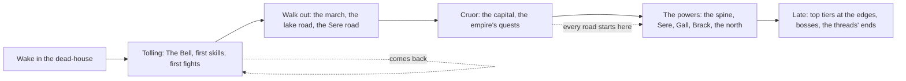
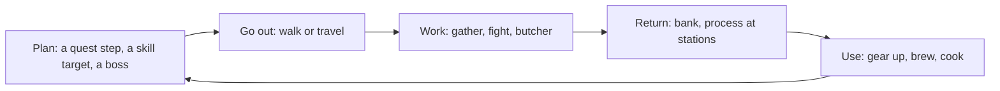

# Game flow summary

*Draft (2026-11-03). How a player moves through a session and through the game (Baldwin's game
flow summary). The detail of each loop is in [II, play flow](../2-gameplay/play-flow.md); the
journey through the world is the [beat chart](../2-gameplay/beat-chart.md).*

## Through the game

- **Early** (tiers 1 to 3, novice and intermediate quests): Tolling and the heartland round it.
- **Mid** (tiers 4 to 6): the powers' lands; each holds the best of one or two skills.
- **Late** (tiers 7 to 10): the dangerous cores of every land, the deep, the moonfalls, the Dreaming.

Stages are for checking spread, never gates: a player can walk anywhere, and an area keeps reasons
to come back at every stage.

## Through a session

A session can be one loop or many. Death breaks it: the ferryman holds what you carried until you
pay or walk back for it ([death](../2-gameplay/death.md)).
