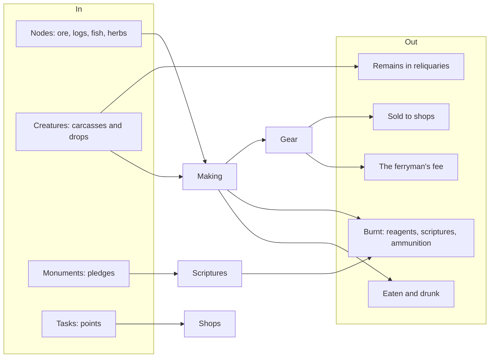

# Economy

*Draft (2026-11-03). From `docs/systems.md`, `docs/skills.md` and `CLAUDE.md` (M3, M5, D1). Drawn as
Librande's resource flow.*

## Summary

With a few hundred friends there is no market to lean on, so the economy is mostly one player's:
what they gather, make and use. Coin, points pools and a bank tie it together; the ferryman's fee is
the biggest drain.

## Goals

- Every player can supply themselves ([pillar 1](../1-overview/pillars.md)).
- Gear and materials keep a purpose: something must take them out of the game.

## Resource flow

## Currencies

| Currency | Earned by | Spent at |
| --- | --- | --- |
| **Coin** (minted by the church) | selling to shops, drops | shops; the ferryman's fee |
| **Pledges** | empowering monuments | scriptures, from Cruor's people |
| **Task points**, one pool per task-giver (yard tokens, Corvin's favour) | tasks | that giver's shop |
| **House favour** (designed) | an occult house's rites and quests | that house's higher rites and spells |

## Banks and shops

- **The bank** holds 400 slots and everything stacks in it; it is a strongbox, a banker or a chest
  in some places, not every place. Unstackable items can be withdrawn as notes.
- **Shops** have stock shared by everyone that restocks over time; some buy back.

## Open questions

1. **A sink for gear** (decided that one is needed, 2026-10-21): gear doesn't wear out, so Smithing
   and Tailoring have little lasting demand. Something like alchemy, or a bigger system. Not designed.
2. The church's coin and its name.
