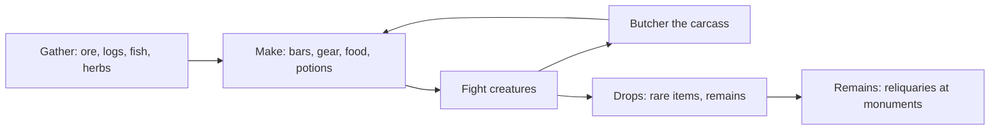
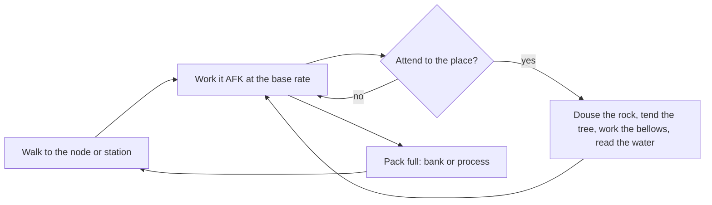
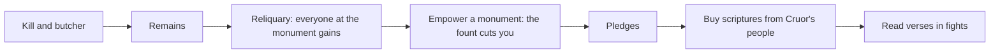

# Play flow

*Draft (2026-11-03). The loops a session is made of, one diagram each (Librande). The rules are on
each mechanic's and skill's page.*

## The core loop

Killing things is how most materials enter the world, and the carcass is where combat and skilling
meet. Everything a fight needs comes back out of the skills.

## A fight's supply

| A fight needs | Made by | From |
| --- | --- | --- |
| Food (blood) | Cooking | Fishing, Butchering, Foraging |
| Potions | Medicine | Foraging, Butchering, Fishing, Mining |
| Reagents (occult spells) | Occultism's rites | Butchering, Mining, Woodcutting, Dreaming |
| Ammunition | Artifice | Smithing, Woodcutting, Butchering |
| Verses (melee's power) | bought with pledges | Religion at monuments |
| Hymns | devotion, restored at altars and by draughts | Religion, Medicine |
| Weapons and armour | Smithing, Artifice, Tailoring | Mining, Woodcutting, Butchering, Foraging |

## The skilling session

## The Religion loop

