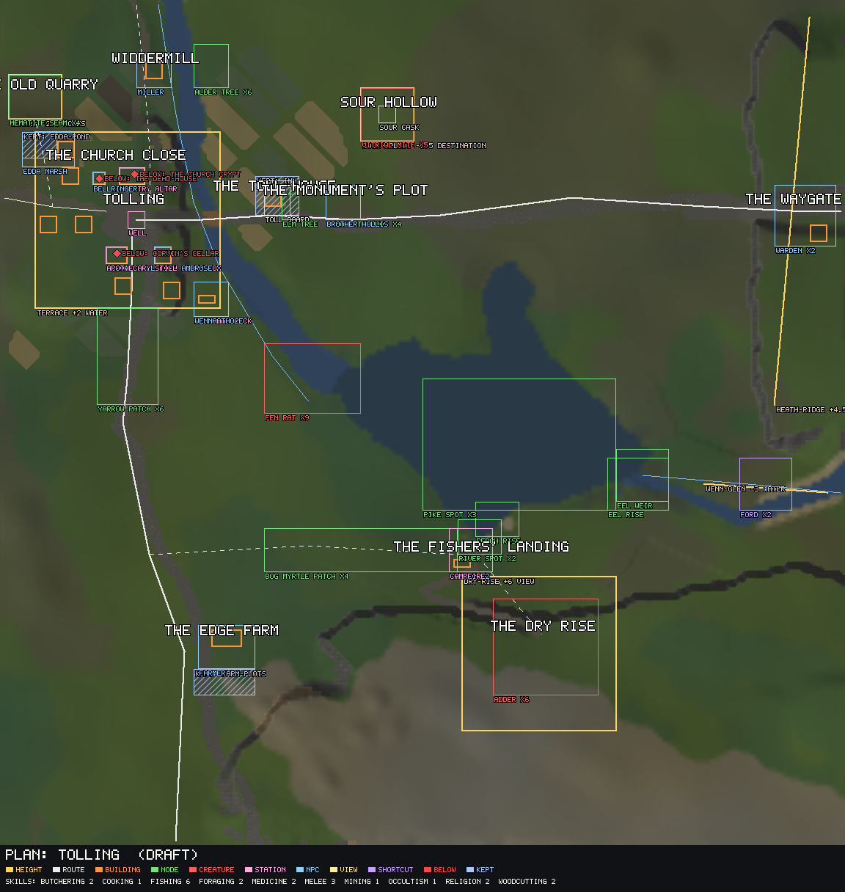

# Tolling and Wennow

*Draft (2026-11-03): the paper design, for the owner. Rewritten to the GDD's rules from
`docs/areas/tolling-plan.md` (draft 2, 2026-11-03), `docs/areas/tolling.md` (the brief, agreed
2026-10-27), `docs/areas/tolling-bell-tower.md`, `docs/areas/heartland-vision.md` (proposed) and
`docs/quests/the-bell.md`. What the owner decided is marked **decided**; the rest is proposed. Its seed
is in [III, areas](../../../3-story/areas.md).*

## Synopsis

Tolling is a small river town at the empire's western edge, where the green country starts to dry
out towards Sere: a church, a toll road, the trades that serve travellers, a few homes, and a broad
mere called Wennow below it. Every player starts here, waking in the dead-house under the bell tower.
The town introduces a few things through its people and hands the player its first mysteries; the
skills themselves are learned out round the mere, and the quests, the roads and what can be seen from
town make the player want to leave. Later, Tolling's people pull them back into longer stories, and
Wennow's record and revised fish bring late anglers home.

## Objectives

1. **Start every player well:** the first things they need, each from a person, each pointing
   outward. ([Pillar 1](../../../1-overview/pillars.md): the first supply loops; [pillar 2](../../../1-overview/pillars.md): the first mysteries.)
2. **Make them want to leave** (decided by the owner as the area's purpose). The town is not where
   skills are trained up.
3. **Give reasons to come back** at mid and late stages ([pillar 3](../../../1-overview/pillars.md)):
   quest lines, resources the land gives at every level, the area's achievements.

| Stage | Draws |
| --- | --- |
| Early | The Bell, Dreamless; perch at the landing, rats in the reeds, yarrow on the verges, alders by the mill; the monument on Palmerway; Wenna's and Corvin's tasks |
| Mid | Tolling's people's quest lines; hematite in the old quarry, the old elm, pike, eels, bog myrtle |
| Late | The area's harder achievements; Wennow's record fish and revised fish |

## Introductory material

- **Arrival:** every new player wakes on a bier in the dead-house, a cold vault under the bell tower,
  under a shroud, by candlelight. There is no opening scene: they climb the stair into the tower's
  hall, where the bell-ringer stares at them, and walk out through the door into daylight, the
  churchyard's graves and the bell overhead. The square is 15 tiles south.
- **The hook:** the first thing the game shows them is that they were dead.
- **The square** points outward: a fingerpost naming the four roads, a notice board with work round
  the area, the well. There are no stations in the square.

## Physical description

A low river basin. Tolling's river comes down from the foothills in the north-west, past Widdermill,
through the town and its bridge, into Wennow, a broad mere, and on east. The town stands dry above the
water meadows; north and west the heath rises gently, east the heath ridge closes the basin with the
waygate on its crest, and south beyond the mere the grass gives out to gravel: the edge of Sere's dry
country. Five grounds and fields: grass and meadow, heath, reeds at the water's edge, the mere, and
the gravel of the dry south.

The town is old, humble stone: rubble walls in courses, slate, the bell tower made taller than
anything round it because the bell had to be heard across the water. The church's red is for its
banners and glass only. Dark and weathered, overcast, olive grass in broad patches.

## Map

Drawn by `tools/world plan render` from the plan data; regenerate it rather than edit it. Four regions,
Tolling's south-west corner at (0, 0).

- **Tolling** (about (30, 48)). Four roads cross on dry ground above a river and its bridge; a toll
  was taken on the road and a church was built at the crossing. It holds the church close, the
  square, Corvin's apothecary, the church house (the bank), the skinning yard downstream and homes.
  **No forge** (decided).
- **The church close.** The oldest ground, on the town's highest corner: the chapel and the bell tower
  together, and the graves of Wennow's drowned.
- **The bell tower.** A plain parish tower, 3 by 3 tiles, three floors: the hall (the stair down to
  the dead-house), the ringing chamber (the bell-ringer's), and the open belfry with a view over the
  basin. Free-standing a few tiles off the chapel's west end (proposed).
- **Widdermill** (35, 80). The mill whose wheel turns against the river; the miller; alders on its
  bank.
- **The old quarry** (off the west road). The stone of the chapel and church house came from here;
  mostly worked out. Hematite in its faces, rust-red streaks where "the rock bleeds". Its crane is
  seen from the road.
- **The toll-house and the old elm** (60, 49). An empty toll-house, its bar in the verge, a board of
  old tolls; an old elm beside it.
- **The monument** (78, 50) on Palmerway. One of the church's blood monuments, raised along the
  empire's roads; Brother Hollis keeps it.
- **Sour Hollow** (in the heath north of Palmerway). A damp hollow where a leaking cask of vitriol
  was dumped out of sight; yellow-stained ground in green heath, seen from the road. The mites breed
  in it.
- **The river mouth.** Reeds where the river enters Wennow, and fen rats in them.
- **The fishers' landing** (109, -31), across the mere. The one sheltered bay on Wennow: a hut, a
  jetty, boats. Where the player was pulled out. From here the town's roofs and the bell tower show
  across the water, at the fog's edge: the area's one picture.
- **The dry rise** (123, -49). The first dry ground south of Wennow: a gravel hill with a rock tor and
  a cairn on top, looking back over the mere.
- **The edge farm** (50, -50) on the Sere road. The last green farm before the gravel, its field
  walls running out into the dry.
- **The waygate** (180, 48) on the heath ridge's crest. Palmerway crests the ridge here; wardens
  watch the road. The threshold of the start area, on the skyline as you walk east.

## Critical path

How a new player goes through Tolling the first time, following The Bell.

| # | Where | What happens | What pulls them on |
| --- | --- | --- | --- |
| 1 | The dead-house | Wake on the bier; the bell-ringer at the foot of the stairs | He sends them to the clerk |
| 2 | The church house | Clerk Ambrose: the ledger has them down as dead; their belongings are in the strongbox (the first use of the bank) | Sent to the apothecary |
| 3 | The apothecary | Corvin looks them over, too curious; the first potions | The Bell sends them where they were found |
| 4 | The river mouth | Rats in the reeds (the first fight; Wenna's first task on the way) | The path round the mere |
| 5 | The fishers' landing | Where they were pulled out; the fishers (proposed: they teach fishing and cooking) | The dry rise behind; Edda |
| 6 | The pond | Edda, asleep on her feet, says something only the ferryman would know | Back to the church |
| 7 | The chapel | The entry struck out; the bell has never been wrong; its twin hangs drowned in Knellmere | East, along Palmerway |

**Branches:** Dreamless (Edda, the rats' galls, Corvin); Wenna's tasks (rats, then mites in Sour
Hollow); the monument on Palmerway (Religion); the miller's and the farmer's errands (proposed); the
dry rise's cairn.

## Encounters

**People**

| Who | Where | Offers |
| --- | --- | --- |
| [The bell-ringer](../../../3-story/people/bell-ringer.md) | the tower; his house | The Bell |
| [Clerk Ambrose](../../../3-story/people/clerk-ambrose.md) | the church house | the bank; the ledger |
| [Corvin Sallow](../../../3-story/people/corvin-sallow.md) | the apothecary | potions; mite tasks; Dreamless; later his cellar |
| [Edda Marsh](../../../3-story/people/edda-marsh.md) | by the pond | Dreamless; The Bell step 5 |
| [Wenna Thole](../../../3-story/people/wenna-thole.md) | the skinning yard | Butchering tasks and her shop |
| [Brother Hollis](../../../3-story/people/brother-hollis.md) | the monument | Religion; scriptures for pledges; the first weapons |
| [The fishers](../../../3-story/people/fishers.md) | the landing | The Bell step 4 |
| The miller, the farmer, the wardens | the mill, the edge farm, the waygate | errands; the road east (proposed) |

**Creatures**

| What | How many | Where | How dangerous | Why here |
| --- | --- | --- | --- | --- |
| [Fen rat](../../../3-story/creatures/fen-rat.md) | about 9 | the reeds at the river's mouth | very low, passive | rats in the reeds; Wenna's first task; Dreamless's galls |
| [Vitriol mite](../../../3-story/creatures/vitriol-mite.md) | about 5 | Sour Hollow | low, attacks on sight | they breed in the vitriol; kept away from the town and the roads |
| Adder (new, proposed) | about 6 | the dry rise | low, passive | dry, sunny gravel; hide and a venom gland |

**The basin stays calm** (decided 2026-10-27): danger starts at its edges.

**Resources**

| Skill | What, where | Levels | Why it belongs here |
| --- | --- | --- | --- |
| Fishing | perch off the landing; an eel weir where the river leaves Wennow; pike in Wennow; trophy perch and eel | 1 to 30; records late | the fishers' mere |
| Woodcutting | alders on the mill's bank; the old elm by the toll-house (a big shared tree) | 1 to 10; 20 to 30 | alders by rivers, elms by old roads |
| Mining | hematite in the old quarry | 20 to 30 | an old church quarry |
| Foraging | yarrow on the verges; bog myrtle on Wennow's south shore | 1 to 10; 30 to 40 | yarrow for Corvin; bog myrtle's home includes Wennow's shores |
| Butchering | skinning rack and lye vat at the skinning yard | 1 to 15 | the town's own trade |
| Religion | the chapel's altar; the monument's founts | 1 to 10 | the church is why the town exists |
| Medicine | Corvin's bench; the square's well for water | 1 to 20 | Corvin introduces it |
| Cooking | the fishers' fire | 1 to 20 | taught where the fish are |
| Melee, Defence | rats, mites, adders | 1 to 15 | |
| Occultism | Corvin's still, in his cellar (later) | mid | his secret |
| Dreaming | Edda's pond, kept for an orb | later | her thread |
| Smithing | none: no forge (decided) | | a quest may send the player to a smith elsewhere |
| Ranged, Artifice, Tailoring | none | | nothing here teaches or needs them |

Early content is 45 to 110 tiles out from the square, so learning it means going out.

**Services:** the bank (the church house); Corvin's shops; Wenna's shop; the chapel's altar (devotion);
the monument; the tinker's cart (tools; where it stands is not set).

**Discoveries:** the board of old tolls; the yellow ground of Sour Hollow; the cairn's view; the
crypt's blocked arch.

**Below ground:** [the dead-house, the crypt and Corvin's cellar](the-dead-house.md).

## Walkthrough

- **A new player:** wakes; the bell-ringer, the clerk, Corvin; the reeds and the rats; round the mere
  to the landing and the fishers; up the dry rise, or back to Edda and the chapel to finish The Bell.
  The fingerpost, the notice board, the monument on the road east and the bell's twin send them out.
- **Early to mid:** Dreamless; Corvin's and Wenna's tasks to Sour Hollow and the dry rise; then east to
  the lake, west to the march, or south.
- **Mid, coming back:** Tolling's people's quest lines; the quarry's hematite; the elm; pike and bog
  myrtle; Wenna for carcasses from further out.
- **Late:** the harder achievements across the area; Wennow's records and revised fish.

**Walking times from the square:** the bank and apothecary 6 s; the mill 19 s; the quarry 21 s; the
monument 29 s; Sour Hollow 38 s; the river mouth 36 s; the edge farm 60 s; the landing 66 s; the dry
rise 81 s; the waygate 90 s.

## Closing material

| Way out | What pulls them | Seen from town |
| --- | --- | --- |
| East, Palmerway | the monument; Wenna's errand to the reed fens beyond the waygate; the bell's twin in the drowned belfry | the monument's stone, from the bridge |
| South, the Sere road | where they were found; the dry rise | the landing across the water from the river mouth |
| North-east, the heath | Sour Hollow | from Palmerway |
| North, Hollow lane | the miller | the wheel, from the church close |
| West, the west road | the old quarry; the road on to the march | the quarry's crane |

**Long views** (decided): the fog stays at 85 tiles and view points don't pull it back; landmarks come
into view as players explore and draw them on.

**Achievements** (proposed):

| Tier | Asks for |
| --- | --- |
| Easy | finish The Bell; climb the bell tower; catch a perch at the landing; butcher a rat for Wenna; empower the monument once |
| Medium | finish Dreamless; clear Sour Hollow's mites; set an eel trap; mine hematite in the old quarry; reach the dry rise's cairn |
| Hard | catch a pike in Wennow; pick bog myrtle; fell the old elm with others; Corvin's quest line |
| Elite | Edda's quest line; the bell's quest line |
| Master | a record perch from Wennow; a revised fish from Wennow for the collector |

## Connections

| Neighbour | What crosses | Questions for its design |
| --- | --- | --- |
| The western march | the west road and the salt road; the spine seen west | does the march keep the cave as Corvin's errand? |
| Knellmere and the lake road | Palmerway over the waygate's crest; the reed fens; the drowned belfry | does it take up the bell's twin? |
| The great bridge and the dry valley | Hollow lane north; Tolling's river from the north | what does the dry valley offer someone coming up Hollow lane? |
| Sere's river: the salient | the Sere road south; Corvin's saltfigs come up it | |

## Assets

From the village kit (first pass): buildings, the bell tower, the mill, the waygate, the jetty and
boats, graves, the cairn. New: the quarry's faces and crane; Sour Hollow's cask; the old elm; the
dead-house, crypt and cellar interiors; the adder; the new people.

## Kept for later

The toll-house for an inn; the edge farm's yard for farming plots, if Farming comes; Edda's pond for the
first Dreaming orb; the crypt's blocked arch for an older vault.

## Open questions

1. **The town's ground:** the brief decided a low knoll with the tower on its crown (2026-10-27); the
   heartland vision proposes a level terrace instead, after the owner rejected the first levels pass
   as arbitrary height (2026-11-03). Which?
2. **Sour Hollow's mites** attack on sight, but the basin is decided calm. Is Sour Hollow outside the
   basin, or the exception?
3. **The waygate:** why is it there? A watch and toll, open to walkers (proposed); a cordon; or
   nothing, leaving a waystone on the crest.
4. **The adder** as the dry rise's creature.
5. **No copper or iron here:** the quarry holds hematite only (tier 3), yet the starter kit has a
   pickaxe. Where does a new player first mine? (The heartland vision proposed copper and iron in the
   quarry; the later plan dropped them.)
6. **The tinker** (tools) has no place in the plan.
7. **Fishers:** do they teach fishing and cooking at the landing (the plan), or only show the spot (The
   Bell)?
