# Windows

*Draft (2026-11-03). From `docs/interface.md`. Built (Milestone 8, U2), except where marked.*

## Summary

A modern dark-fantasy interface over an old-school world. Everything sits in movable windows that
snap together, share tabs and remember where you put them, in the classic arrangement by default.
The game has more combat resources than either RuneScape, so it has more interface than Old School.

```mermaid
flowchart TB
  HUD[Always on screen] --> Bar[Main action bar: blood, phlegm, devotion, bile, 14 slots]
  HUD --> Bars2[Up to four more bars]
  HUD --> Mini[Minimap: compass, clock, run, map, journal, guide, settings, every window]
  HUD --> Chat
  HUD --> Target
  HUD --> Buffs[Buffs and debuffs]
  HUD --> XP[Experience drops]
  Side[Side window tabs] --> Pack & Worn & Abilities & Religion & Skills & Quests & Task & Tracker
  Modals --> Journal[Journal: quests, achievements, bestiary]
  Modals --> Guide[Guide: skills, abilities]
  Modals --> Map[World map]
  Modals --> Settings
  Modals --> Character[Character: stats, inspect]
  Server[Opened by the world] --> Bank & Shop & Conversation & Make[Make window]
```

## Always on screen

- **Main action bar:** blood, phlegm and devotion as three gauges, the bile axis filling outward from a
  black centre, and fourteen slots on the number keys. Abilities, hymns, verses and items are dragged
  onto it; each style keeps its own main bar, swapped in with the weapon.
- **Minimap:** round, turning with the camera, click to walk; compass, the real local time (a day in R'th
  is a real day), and buttons for run, the world map, the journal, the guides, settings and a menu of
  every window.
- **Chat, the target, buffs and debuffs, experience drops** rising from the skill's icon.

## Side window tabs

Pack (28 slots), worn equipment (with buttons for combat stats and inspect), the ability books (one per
style, and Defence), Religion (hymns and verses), skills (with level targets), quests, task, experience
tracker. To come: spellbooks, friends, group.

## Modals

- **Journal:** quests in full, the achievement diary by area and tier, the bestiary (by region, with a
  drop log that hints: a notable drop shows as a silhouette under a "?" until you have had one).
- **Guide:** every skill's unlocks in level order, gathered from the game itself; every ability as a card.
- **World map:** the continent painted from the same layout the world is built from; places by tier,
  unnamed places as marks; your own marker.
- **Settings** and **Character** (stats; inspect, also on other players).

## Opened by the world

The bank (with pack and worn tabs, notes, withdraw-X), shops, the conversation box (message, then
reply), the make window (choose a recipe and an amount), the rig window for a fishing rod.

## Open questions

1. To come: run energy (now decided: none), friends, group and private chat, announcements, waystone
   travel on the map.
