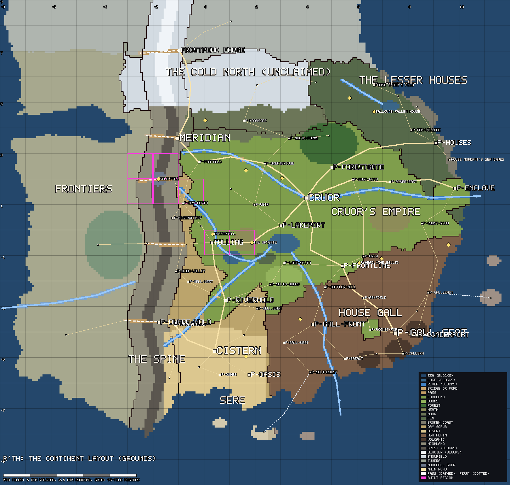

# The continent layout (L1)

Status: **ready for the owner's review** (2026-10-22). Workstream L1 in [plan.md](plan.md).

The whole continent, roughly, at real tile scale: coast, sea and islands, the spine and its passes,
rivers and lakes, ground kinds, the powers' borders, settlements and landmarks, the main roads, and
the 96-tile region grid over all of it. It is one text file, compiled and checked by
`tools/world`, so it can be tuned by changing numbers and re-running one command.

It turns the concept map (`lore-rework/concept-map.png`) into a layout you can measure. It does
not build regions (that is L2), and `p-` names are placeholders that never reach players.



| Render | What it shows |
| --- | --- |
| [layout-continent.png](images/layout-continent.png) | Ground kinds, power borders, rivers with their flow, roads, passes (dashed), ferries (dotted), places, the region grid (numbered every other region), the built regions (magenta), a 500-tile scale bar. 0.75 px a tile. |
| [layout-powers.png](images/layout-powers.png) | The same, coloured by power. Frontiers are fogged. |
| [layout-heartland.png](images/layout-heartland.png) | Tolling, Palmerway and Cruor at 2 px a tile, with every region's key (`rx,ry`). |

## 1. The numbers

From `dotnet run --project tools/world -- layout` (the same checks run in `dotnet test`).

| | |
| --- | --- |
| Layout rectangle | x -768..1151, y -864..959: 20 × 19 regions (1920 × 1824 tiles) |
| **Core land** (the first build) | **1.43M tiles**: target 1.2-1.5M; the 2004 game's main continent is 0.73M, RS3's mainland more |
| Frontier land (beyond the spine, the far north) | 0.77M tiles, fogged on the renders |
| Islands (by ferry) | 5 small ones, 0.01M tiles |
| Regions | 286 regions of 96 × 96 hold land; **172 are mostly core land**, 190 touch it |
| Settlements | 4 cities, 12 towns, 29 villages, 19 hamlets; 13 landmarks |
| Ladder (T-LADDER) | 0.84 towns and 2.03 villages per 100k core tiles (targets 0.5-1.5 and 1.5-4) |
| Built share (T-LAND-BUILT) | about 11%, estimated from the tiers (target 10-20%) |
| Cruor against the next city (T-CITY-DOMINANCE, by area) | 2.1 × (target 1.5-3) |
| Reach | every place reachable from Tolling over land, bridges, passes or ferries |

**Land per power** (of the core, against `lore-rework/powers.md`):

| Power | Share | Guide |
| --- | --- | --- |
| Cruor's empire | 34.8% | 30-35% |
| House Gall | 17.2% | ~15% (12-18) |
| The spine (surface people) | 17.1% | ~15% (12-18) |
| Sere | 11.0% | ~10% (7-13) |
| The cold north (unclaimed) | 10.6% | "frontiers and wild land ~15%" (10-20) |
| The lesser houses | 9.3% | ~10% (7-13) |

**Travel between capitals**, on foot along roads (route tiles; minutes at 0.6 s a tick, walking one
tile a tick, running two):

| From | To | Straight | By road | Walk | Run |
| --- | --- | --- | --- | --- | --- |
| Tolling | Cruor | 354 | 368 | 3.7 | 1.8 |
| Tolling | Cistern | 408 | 408 | 4.1 | 2.0 |
| Tolling | Meridian | 392 | 392 | 3.9 | 2.0 |
| Cruor | Meridian | 484 | 504 | 5.0 | 2.5 |
| Cruor | p-houses | 488 | 504 | 5.0 | 2.5 |
| Cruor | p-gall-seat | 508 | 568 | 5.7 | 2.8 |
| Cruor | Frostpeak Forge | 554 | 832 | 8.3 | 4.2 |
| Cruor | Cistern | 576 | 752 | 7.5 | 3.8 |
| Meridian | Frostpeak Forge | 330 | 328 | 3.3 | 1.6 |
| Cistern | p-gall-seat | 680 | 896 | 9.0 | 4.5 |

RuneScape for comparison (straight lines, `areas/scale-compare.png`): Varrock-Falador 230,
Varrock-Lumbridge 228, Varrock-Ardougne 587, Lumbridge-Menaphos about 500. Every capital's nearest
other capital here is 330-500 tiles away; the full table (21 pairs) is printed by the command.

## 2. Files

```
world/layout/continent.json   the layout: edit this                                    (everyone)
world/layout/zones.json       the zone grid in the WorldLayout format, for the bake    (generated)
world/layout/regions.txt      the 96-tile region grid: realm and rough role of each    (generated)
docs/images/layout-*.png      the renders                                              (generated)
shared/World/Layout/          the data model, compiler and checks (C#, no Unity)
tools/world (layout command)  runs it all
```

```powershell
dotnet run --project tools/world -- layout         # check, write zones.json and regions.txt, draw the renders
dotnet run --project tools/world -- layout check   # only check, and that the generated files are up to date
dotnet test server/Rth.Tests                       # includes ContinentLayoutTests (the same checks)
```

**It extends the layout prototype** (`world-building.md`, `shared/World/WorldLayout.cs`) instead of
starting another format: `zones.json` *is* a `WorldLayout` (a biome letter and a macro height per
8 × 8 zone, rows from the north), and **R'th > World > Bake Terrain From Layout** now reads it
(`LayoutBaker`, falling back to the old `client/Assets/World/layout.json` if it is missing). What is
new is the layer above the grid: shapes and lines in tiles, which is what makes it tunable. The
sketch-made `layout.json` and `tools/world-layout/` are superseded but left in place.

## 3. The data format

Everything is in **absolute tiles**: Tolling's south-west corner is (0, 0), east is +x, north is +y.
Rectangles exclude their far edges, as in `world/regions`.

| Section | What it is |
| --- | --- |
| `bounds` | The layout's rectangle `[x0, y0, x1, y1]`, multiples of 96 so the region grid lines up. |
| `scale`, `anchor` | A tuning knob: every point, width and radius is stretched by `scale` about `anchor` (Tolling's middle) before compiling. River, road and pass widths are not. `1.0` means the file's numbers are the tiles. |
| `seed` | Seeds the rough edges (and the bake's base noise). |
| `grounds` | Ground kinds by id: `letter` (its character in `zones.json`), `palette` (the bake's colour, a name in the art palette), `map` (the render's colour), `water`, `walkable`, `rough` (the bake's noise, tiles) and `height` (the macro height in tiles, lowered within three zones of the sea). |
| `powers` | Who holds land: `name`, `colour`, default `ground`, `core` (false for frontiers), `share` (the guide from `powers.md`), `label` (where the render writes the name). |
| `tiers` | Settlement tiers with a rough `built` area and width `across` (from `research/world-density.md`). |
| `land` | Shapes that are land; the rest is sea. `"by": "ship"` marks an island reached by ferry. |
| `seas` | Water cut back out of the land (the western sound, the southern gulf). |
| `realms` | Shapes painted with a `power`, **in order**: later shapes win, so the salients come last. Land no shape covers takes its nearest neighbour's power. |
| `areas` | Shapes painted with a `ground` over each power's default, in order: forests, moors, desert, lakes, volcanoes, the crest. |
| `spine` | The spine's crest `line` (south to north) and its `passes`: lines that cut the crest and the highland as walkable pass ground, and count as roads. |
| `rivers` | Lines from source to mouth (the order is the flow), `halfWidth`, and `into`: `sea`, `lake:<area id>` or `river:<river id>`. |
| `places` | `id`, `name`, `tier` (city, town, village, hamlet or landmark), `at`, `capital` (travel is measured between capitals), optional `across` and `note`. |
| `roads` | `kind` (`main`, `road` or `ferry`) and a `line` of stops: place ids or `[x, y]` bends. A road over a river makes a bridge; over the crest or open water it is an error (use a pass or a ferry). |
| `regionNotes` | A note on a region's role, by `"rx,ry"`; it goes in front of the computed role in `regions.txt`. |
| `targets` | The layout's own targets (core size, nearest capital, unreachable share). T-LADDER, T-LAND-BUILT and T-CITY-DOMINANCE are read from `docs/areas/targets.json`. |

**Shapes** are one of: a polygon `poly` (with `rough`: how far, in tiles, its edges wander, the same
way for every shape that shares the edge, so borders meet); a band `line` + `halfWidth` (or
`"along": "spine"`); an `ellipse` `[cx, cy, rx, ry]`. `minY` / `maxY` clip any shape.

**How a zone is decided** (8 × 8 tiles, by its centre): land or sea; then its power (the last realm
covering it); then its ground (the power's default, then areas in order); then rivers over land;
then passes (over a river: a bridge); then roads (over a river: a bridge). Heights come from the
ground and the distance to the sea.

**`regions.txt`** gives every region with land: tiles, land and core share, realm (the majority
power) and a rough role read off the layout: the built region, the settlements and landmarks in
it, a pass, or "open <ground>", plus road, river, lake and coast.

## 4. Tuning

Edit `continent.json`, run `layout`, look at the renders and the checks.

| To make it... | Change |
| --- | --- |
| **Bigger or smaller overall** | `scale` (0.9 shrinks the core to 1.17M tiles, 138 regions, and every distance by 10%; 1.1 grows it to 1.71M and needs wider `bounds`). Tolling and Palmerway stay put; everything else moves away from or towards them. Rough coasts wander differently at a new scale, so the checks may then flag a coastal place standing in the sea: nudge it inland. To keep a new size, move the numbers and set `scale` back to 1. |
| **Capitals further apart or closer** | Move the place's `at`, and the realm borders and roads around it. The `travel` check warns when a capital's nearest other capital leaves `targets.nearestCapital`. |
| **Denser (more to find)** | Add places (villages and hamlets mostly). The ladder check counts them against T-LADDER per 100k core tiles. Shrinking `scale` also makes the same places denser. |
| **Sparser** | Remove places, or raise `scale`. |
| **A power's share** | Move the shared border points in `realms` (they appear in both neighbours' polygons). `shares` reports each power against its guide. |
| **The spine wider or narrower** | `halfWidth` of `the-range` (the surface people's land, 75), `crest` and `crest-cold` (the impassable rock, 20 and 24). |
| **Another crossing of the spine** | Add a `pass` line across the crest, and a road to each end. |
| **Coasts more or less ragged** | `rough` on the land polygon (64) and on realms (30). |
| **The cold further south** | `minY` on `cold-slopes` and `crest-cold` (560), and the `cold-north` realm. |

## 5. Choices made

- **Scale:** the concept map's own scale bar (about 1.7 tiles a pixel), trimmed to a 1.43M-tile
  core: twice the 2004 continent, as the brief asks, with frontiers beyond.
- **Tolling** stays at (0, 0) and **Palmerway** at 96-191: the empire's western edge, where farmland
  meets Sere's scrub, 140-180 tiles east of the spine's crest. Palmerway's road runs east past the
  waygate to **p-lakeport** on p-lake's north shore, then north-east to **Cruor** (368 tiles by road).
- **Rivers, matching the built regions:** Tolling's river comes from the foothills in the
  north-west, through Tolling (as built) into **Wennow** at Tolling's south-east corner, then east
  into **p-lake**. **Sere's river** rises in the spine above the dwarves' pass and joins it below
  Wennow; the empire's salient runs up it to p-riverhold. **p-lake** drains south through the Gall
  front (**p-outflow**) to the sea. **The great river** rises in the foothills below Meridian and
  runs past Cruor to the east coast at the empire's enclave. A sixth drains the lesser houses' fens.
- **The spine** runs south to north along x ≈ -140 to -215, a 40-tile impassable crest (ice north
  of y 560) inside a 150-tile band of the surface people's highland, with **five passes**: the
  dwarves' pass (by p-dwarf-hold), p-salt-pass (west of Tolling), **Selenfall's breach** (the
  moonfall crater cuts the crest), p-meridian-pass and p-frost-pass by Frostpeak Forge.
- **The four salients** are where the concept map puts them: up Sere's river, into the foothills
  below Meridian, a fortress pocket by Gall's seat, and a coastal enclave in the houses' fens.
- **p-head** is on the empire-Gall front south-east of p-lake, with p-brow above it; the hidden
  occult cells and the demigods' sites are landmarks where the concept map has them.
- **Capitals** (travel is measured between them): Cruor, Cistern, Meridian, p-gall-seat (cities),
  Frostpeak Forge and p-houses (towns: a trading hall and a gathering of small houses).
- **The cold north** is unclaimed core land (with the northern moors), so the "wild land" share is
  in the first build; the far north and everything beyond the spine are frontier.
- **Islands** are frontier, reached by two ferries.
- **The instanced regions** (the Saint's crypt and LevelTest, at x ≥ 1016, y ≥ 1008) lie outside
  the layout's rectangle; keep instanced space out there.
- **Decision W2** (`world-building.md`) is answered by this layout: the bay and the Cradle are gone,
  and Tolling sits where `world-map.md` puts it. **W1** (the world's size) becomes `scale`.

## 6. Decisions for the owner

1. **The size.** Core 1.43M tiles (about 172 regions to build). Keep it, or shrink with `scale`
   (0.9 gives 1.17M and 138 regions).
2. **Tolling to Cruor: 368 tiles by road** (3.7 minutes walking, 1.8 running), against about 230 for
   Lumbridge to Varrock. Closer, or keep it as the first long walk?
3. **Sere west of Tolling.** As on the concept map, Sere wraps north between the empire and the spine
   up to Selenfall (a strip 50-100 tiles wide). Keep it, or keep Sere wholly south of Tolling?
4. **The rivers' drainage** above: in particular p-lake draining south through the Gall front.
5. **Five passes**, the nearest 180 tiles west of Tolling. More, fewer, or elsewhere?
6. **The cold north as unclaimed core land** (10.6%), or frontier (the core then shrinks by about
   150k tiles and the empire's share rises to about 39%).
7. **Shares at the edges of their guides**: the empire at 34.8% (of 30-35) and Gall and the spine at
   17% (of about 15). Fine as they are, or rebalance?
8. **Retire the prototype**: delete `client/Assets/World/layout.json` and `tools/world-layout/` now
   that the bake reads `world/layout/zones.json`?

## 7. What comes next

- **A4, pass 1 (the skeleton)** is read off this: `regions.txt` and `continent.json`'s places.
- **L2** generates each core region's sparse ground from `zones.json`, the roads and rivers (as lines,
  in tiles) and a placeholder at each place.
- **L3** draws the world map and minimap from the same data. The world map is done (`WorldChart`,
  docs/interface.md): the server compiles `continent.json` at startup and players get it with the
  content, so editing the layout changes the map at the next server start. `p-` names never reach
  players; `"hidden": true` on a place keeps it off the map.
