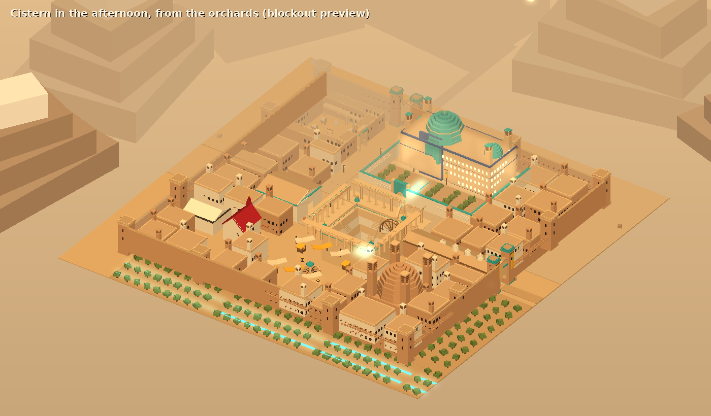
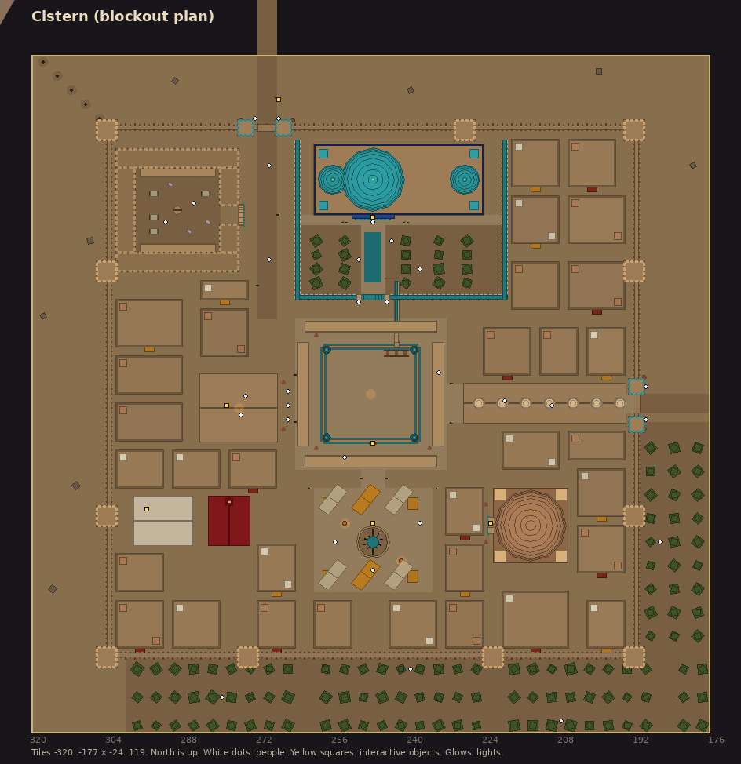
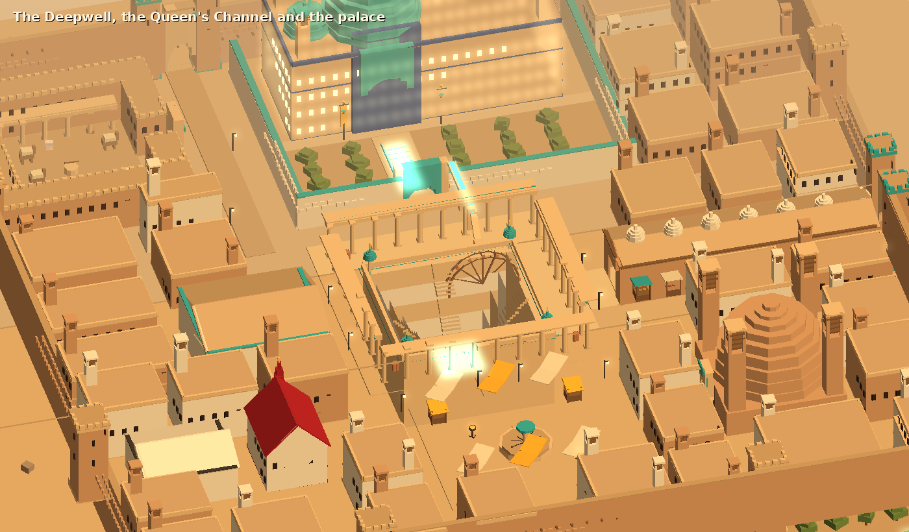

# Cistern

The capital of Sere, the dry kingdom in the rain shadow of Candora, "built around the deepest
wells in the west" (`docs/lore.md`). Queen Saffiya rules it, and plays every power against every
other for water and metal. This is the blockout: every building, street and landmark at its
final size, with placeholder geometry tagged by the asset it stands for. It is built by
`client/Assets/Editor/CisternBuilder.cs` (**R'th > Dev > Rebuild Cistern Scene**), which also
exports the map and writes [cistern-assets.md](cistern-assets.md).

The images come from a headless preview of the builder, not from Unity.

## Mood

A dusty amber afternoon. Ochre mud-brick and sandstone, lime plaster on the better houses,
turquoise and lapis tile on anything that matters, saffron and madder cloth; a windcatcher on
almost every roof; blank walls to the lanes and life inside the courtyards. The mountains stand
up pale through the dust to the west and north, with a Concordian beacon lit on the pass.
**Water is the city's whole story**, and it's shown, not told: the Deepwell everyone walks past
and nobody draws from without a tally, the wheel that sends water to the Queen's garden first,
the long pool where courtiers walk so they're seen beside it, the queue at the Water Office,
water-sellers in the square round a fountain that has been dry for years.

Region atmosphere: a warm low sun (1, 0.8, 0.55) at 1.35, warm ambient, dust-coloured fog (0.82,
0.68, 0.5) from 45 to 112 tiles. Music track `cistern`.

## Where it is

Tiles -320..-177 x -24..119 (144 x 144), well west of Tolling, where the heartland has dried
into Sere. Not joined to the world yet: use `::tele cistern`. The Heartland road comes in from
the east at about (-186, 46).

## Layout

Local coordinates (add -320, -24 for world tiles).

| Place | Where | What's there |
|---|---|---|
| The Deepwell | the Well Court, x 56-87, z 56-87 | A square stepwell 20 tiles across and 9 m deep (the ground is cut away: `WorldKit.CutGround`), five terraces, stair flights, tiled kiosks, a parapet; a colonnade round the court; the well-head (`cistern_deepwell`). |
| The noria and the Queen's Channel | north side of the well | A 9 m water wheel with clay pots lifting water to a channel on piers that crosses the street into the palace garden. |
| The palace | x 56-100, z 92-126 | A walled garden of figs round a long pool, a tiled gate; the palace with a great iwan, a turquoise dome and windcatchers; its doors (`saffiya_doors`). |
| The Water Office | x 36-51, z 62-75 | Walk-in: great measuring jars, clerks' benches, the Rolls (`cistern_water_rolls`); a queue with jars outside. |
| The covered bazaar | x 92-125, z 66-73 | Walk-in: a long vaulted hall with skylight domes from the Well Court to the Heartland Gate, sixteen stalls (rock salt, figs, copper, cloth, jars). |
| The Great Cistern | x 98-113, z 36-51 | The city's reserve under a 10 m mud-brick dome with four windcatchers; a tiled portal over the stair down (`great_cistern`). |
| The fountain square | x 60-84, z 30-51 | The dry fountain (`dry_fountain`), water-sellers' stalls, braziers, shade sails. |
| The caravanserai | x 18-44, z 98-124 | Inside the Pass Gate: arcaded ranges round a court with a well, pack beasts, salt slabs, bales; a tall portal onto the Pass road. |
| Foreign houses | x 22-46, z 40-50 | Tithe's counting-house (walk-in, `synod_strongbox`: the Queen borrows from Tithe) and the Synod's little red-roofed mission. |
| The town | everywhere else | Courtyard houses of mud-brick or lime plaster, flat roofs, windcatchers, carved doors, awnings. |
| Outside | | Fig orchards with irrigation runnels to the south and east; the line of a qanat's shaft mounds coming down from the north-west; the Pass road north with its signpost (`lucern_signpost`); Candora behind. |

About 30 townsfolk: guards, water clerks, water-sellers, caravaneers, courtiers, fig-pickers.
None of them talk yet. Queen Saffiya isn't placed: she should come with her first quest.

## Assets

[cistern-assets.md](cistern-assets.md) lists every stand-in (`cistern/<name>`). The kit grew
three pieces for Sere: `CutGround` (pits), `Windcatcher` and `WaterWheel`.

## Not yet

The pack beast's design, Queen Saffiya and the court, dialogue, water as a mechanic (a ration,
a water-seller), the Great Cistern's interior (a dungeon?), Lucern Pass and the road east to
Tolling, music.
