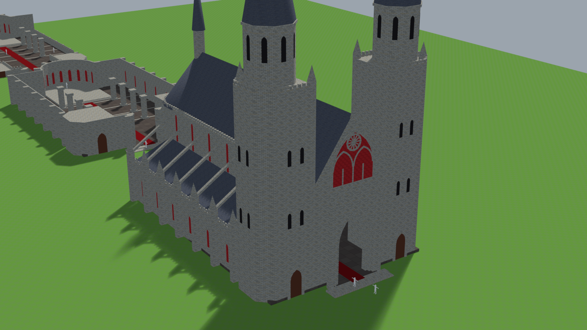
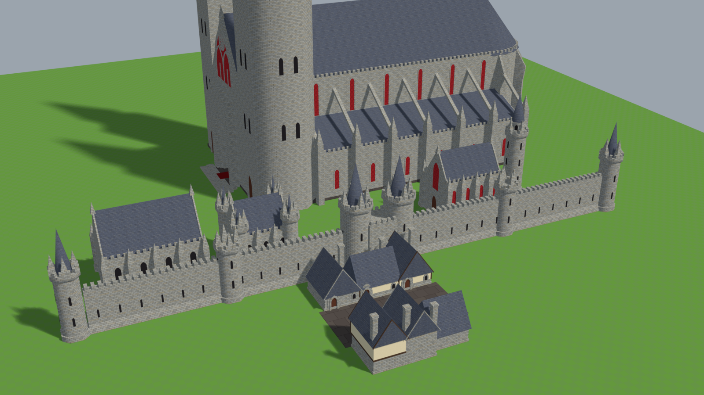
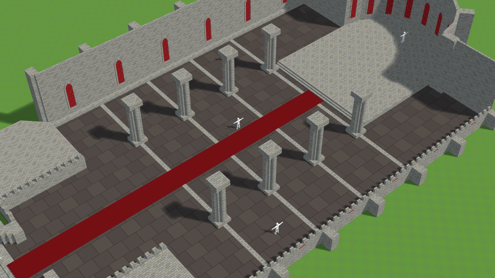
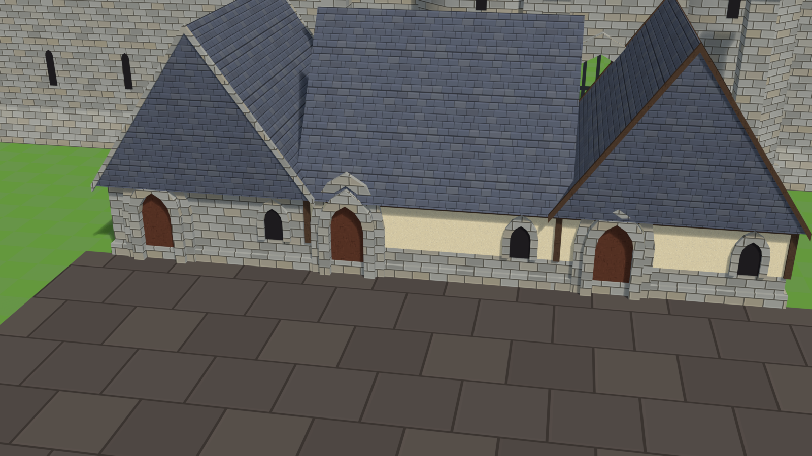

# Cruor: architecture style

How Cruor's buildings are made. The style comes from the cathedral the owner passed on
2026-10-23: the lab's great church, restyled after measurements of Varrock castle
([research](../research/osrs-varrock-castle.md)). The rules below are what made it work.

**The code:**
- `tools/art/blender/buildings/cruor/` has the kit, the cathedral built from it, a showcase of
  every part and the textures (see its README).
- The city's layout direction and building budget are in [cruor.md](cruor.md).

## Decided by the owner

- **The cathedral is massive and intimidating**, the one building that dominates the city. It
  breaks the usual height limits on purpose (nave walls 22 tiles, towers 42 with their spires
  above). Everything else keeps **ordinary sizes**. The city plan makes room for the cathedral, not
  the reverse.
- **Pale stone, red for the faith.** Walls are pale warm grey stone. Red is kept for what must
  stand out and belongs to the empire's religion and to blood: the cathedral's glass first (the
  great window, every lancet), then the chapter house's glass, banners and the red runner. Red is
  never on structure, trims or roofs; buildings that are not the faith's have dark windows.
- **Few buildings, much open space** (about 25–30 in the whole city; [cruor.md](cruor.md)). Houses
  are a handful, and most are a single storey.

## The rules

1. **One stone.** Every stone surface wears the same texture (`CruorStone`):
   - small bricks, about a quarter tile tall and half a tile long;
   - dark mortar outlines, light edges, strong contrast between bricks;
   - the reference castle's idea in our own colours, not a copy.

   Walls carry no painted trims or string courses; they read as one material.
2. **Thin walls.** A wall is a skin, a quarter tile thick (the clerestory half a tile). Mass comes
   from height, buttresses and towers, not from thickness. City walls are the exception: thick
   and walkable.
3. **One repeated silhouette element: the merlon.** One a tile, half a tile long, as wide as the
   wall, along every wall top. The walls that are cut in the inside view get the same merlons, so
   a cut wall still looks finished.
4. **One pinnacle.** A square pyramid five half-widths tall. The same shape stands on every
   buttress, tower corner, gable peak and portal side. There are no other spikes: no crockets,
   gablets or spikes of mixed sizes.
5. **Small windows.**
   - lancets about a tile wide in a thin raised frame;
   - dark slits in the towers;
   - **one** big statement per building, at most (the cathedral's great window with its rose).
6. **Towers are chamfered**, cut at the corners so they read round from the camera, with a
   corbelled band under their merlons and a pinnacle on each chamfer. The important ones go on
   to an octagonal belfry and a slate spire.
7. **Gables are the roof's own ends.** A gable wall follows its roof's eaves and pitch exactly. A
   screen never rises past the roof behind it.
8. **Dark slate roofs**, steep (55°), in neat rows, behind the merlons on stone buildings; houses
   have a short overhang.
9. **Smooth lighting** across shallow edges (the reference's `sharelight`): octagons, apses and
   piers light softly; walls and corners stay crisp.
10. **Fine detail and colour go into dressing**: banners, braziers, lamps, pews, candles. These
    are separate models within the prop budgets, placed on and around the structure, not built
    into the shell.

## Inside

Buildings you walk into are layered (`Layered` in `kit.py`):
- **Base:** always shown, the floor and one storey of every wall.
- **Wall tops:** per side.
- **Crowns:** the merlons on each side's cut.
- **Upper parts and roofs:** hidden inside.

Inside, the far walls stand to full height as the backdrop, and the walls toward the camera are
cut at one storey under their merlons, so nothing stands between the camera and the player.

## The kit

| Part (`kit.py`) | Used for |
| --- | --- |
| `wall`: a skin with a plinth and merlons | Any stone building's walls |
| `buttress`: with the one pinnacle | Halls, the chapter house, the palace, the cathedral |
| `lancet`, `doorway` | Windows (red glass for the faith, dark otherwise); doors in a stone frame |
| `tower`: chamfered, corbelled, merlons, slits; flat, a spire, or a belfry and spire | Wall, corner, beacon and palace towers, the conduit house |
| `hall`: walls, buttresses, lancets, gable ends, slate roof, a door, optional corner turrets | Barracks, armoury, chapter house, hospice, letting house, warehouses |
| `gatehouse`: two spired towers, a pointed arch, a raised portcullis | The city's gates |
| `city_wall`: thick, walkable, merlons on both edges, slits | The curtain wall, the yard wall |
| `townhouse` | Houses (below) |

Houses come in two kinds, with the same stone and slate as everything else:
- **Plaster:** a stone ground floor under jettied plaster storeys framed in dark timber. With
  only one storey it is a cottage: a stone footing and framed plaster walls.
- **Stone:** all stone, with small dark lancets.

Both have steep slate roofs, gable or eaves to the street, and pointed stone doorways. The tavern
and the stables follow the plaster kind.

