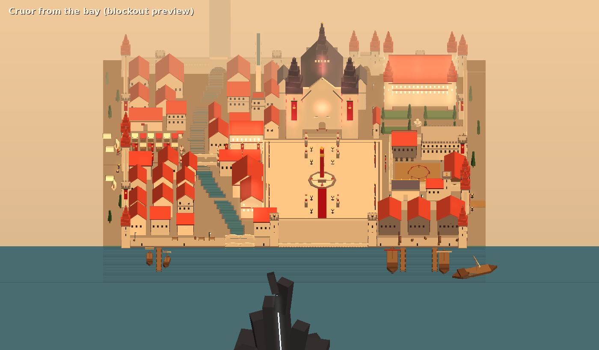
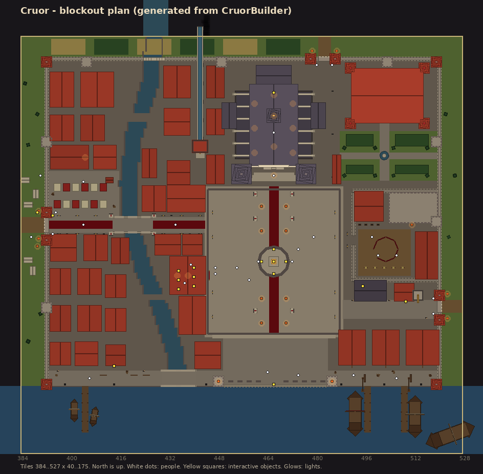
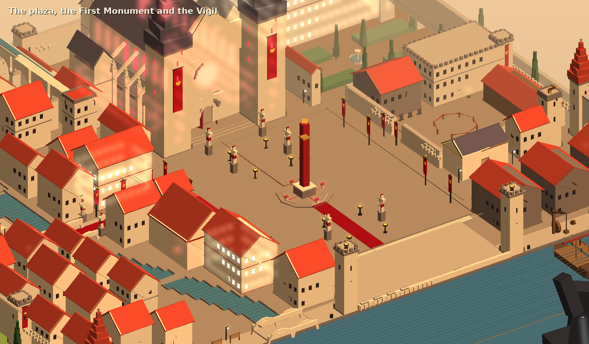

# Cruor

> **Superseded (2026-10-23).** The owner judged this blockout far too dense: unpleasant to cross,
> and impossible to fill with content. Its layout and the counts in its asset list (28 town
> houses, 15 more stone ones, 12 stalls...) are not to be built. Cruor will be laid out again to
> the direction below, with the kit and style in [cruor-architecture.md](cruor-architecture.md).
> The rest of this page describes the old blockout.

## Direction for the new layout

Decided by the owner:
- **The whole city is walled, and the wall is not a rectangle.** It follows the ground, the river
  and the bay.
- **The plaza and the cathedral are the centre.** The cathedral is massive and stands in open
  ground of its own; the city is arranged round it.
- **Lots of open space** gives the impression of a large place: wide streets, plazas, gardens, the
  quays and the Watch.
- **About 25–30 buildings and 80–100 people**, at Varrock's scale (the biggest city in the game,
  but not hundreds of homes). Homes are a handful, and not all of them are more than one storey.

The building budget, a working list:

| Kind | Count | Examples |
| --- | --- | --- |
| The cathedral | 1 | In its own open precinct |
| Faith and state | 3–4 | Chapter house, letting house, the Pontiff's palace |
| Military | 3–4 | Gatehouse, barracks, armoury (wall towers are part of the wall, not counted) |
| Services and shops | 8–10 | The Tithe counting-house (bank), tavern, a few shops, a smithy, the market (counted as one) |
| Harbour | 2–3 | A warehouse, the quay, the Watch |
| Homes | 6–8 | In two or three short rows, each able to hold a quest-giver or shop later |

## The old blockout

The first see of Blood, the richest and most populous city in the basin (`docs/lore.md`). This
was the blockout: every building, street and landmark is in place at its final size, with
placeholder geometry tagged by the asset it stands for. It is built by
`client/Assets/Editor/CruorBuilder.cs` (**R'th > Dev > Rebuild Cruor Scene**), which also
exports the map and writes [cruor-assets.md](cruor-assets.md), the list of assets to make.

The images here come from a headless preview of the builder (flat-shaded boxes in the region's
fog and sun), not from Unity, so expect the real scene to look softer.

## Mood

A late golden haze over pale limestone and red tile. Banners and braziers everywhere, always
lit. Every street runs down to the water, and the whole city faces the bay and what lies in it:
the Quaere, a dark shape on the horizon with a faint red seam, visible from the Watch. Cruor
feels rich, devout, crowded and proud, a little feverish. Red is used for the faith (the runner,
banners, stained glass, the Letting House), gold for Cruor's chalice, dark cypresses for gardens
and graves.

Region atmosphere (`MapArea.ownAtmosphere`): a warm sun (1, 0.82, 0.6) at 1.2, warm ambient,
fog (0.87, 0.73, 0.56) from 55 to 118 tiles. Music track `cruor` (silent until a track exists).

## Where it is

Tiles 384-527 x 40-175 (144 x 136, zone-aligned), well east of Palmerway. The land between is
not built yet, so for now reach it with the dev command `::tele cruor`. The west road enters at
(385, 114).

## Layout

Local coordinates (add 384, 40 for world tiles):

| Place | Where | What's there |
|---|---|---|
| West gate and pilgrims' camp | x 0-8, z 70-80 | Tents outside the walls, a roadside needle (`cruorian_monument`), cypresses. Gatehouse with portcullis, braziers, banners. |
| The Processional Way | z 72-76, x 8-60 | The red runner from the west gate over the Pilgrims' Bridge to the plaza, banner poles, knight statues, a proclamation board (`cruor_proclamation`). |
| The river | north water gate to the bay | Runs through the city between stone quays; the Pilgrims' Bridge crosses it. |
| Plaza of the Keeping | x 60-105, z 38-87 | The city's heart on axis 82.5: the red runner, statues, braziers, the chapter house, the hospice and canons' houses. |
| The First Monument | (82, 62) | The blood needle with four founts (`monument_fount`) and glowing channels. |
| The Watch | south end of the plaza, over the bay | A terrace with a rail (`watch_rail`, Keep-vigil) and two beacon towers, facing the Quaere. |
| The Vigil | north end of the plaza | The cathedral: a 15 x 26 tile nave at 14 m with pews, an altar (`vigil_altar`, pray), stained glass, aisles, transepts, apse, flying buttresses, a crossing spire, two front towers, a rose window. Walk-in. |
| The Letting House | beside the plaza | Walk-in hall where the faithful give blood: six chairs (`letting_chair`), a cistern. Letting sisters. |
| Knights' yard | east of the plaza | Dummies, weapon racks, sparring ring, barracks, armoury, stables. Blood-knights. |
| Pontiff's palace | north-east | Towers, a walled garden with hedges, cypresses and a fountain. |
| The quays | along the shore (z 22) | Jetties, bollards, moored boats, cranes, warehouses. Dockhands. |
| The bay road | east along the shore | The Tithe counting-house (walk-in, `synod_strongbox` bank and counter); the Concordian consulate with its observation tower (`concord_skyglass`). |
| The market | west of the plaza | Twelve stalls, a well, the tavern "the Opened Vein". |
| The lower town | west and south-west | About 24 townhouses, fish racks, street lamps, the shuttered apothecary (`cruor_shuttered_shop`). |
| The aqueduct | north | Piers and arches carrying the channel to a conduit house and fountain. |

About 31 townsfolk stand around (blood knights, pilgrims, Synod cantors, letting sisters,
dockhands); none of them talk yet.

## Assets

[cruor-assets.md](cruor-assets.md) lists every stand-in: its id (`cruor/<name>`), how many are
placed, the size of the largest copy in metres and a note for the artist. The builder rewrites it
on every save, so change the notes in the builder, not the file. In the scene, each stand-in has
a `BlockoutAsset` component with the same id and note; replacing one is: make the model at that
size, swap the placeholder's children for it, keep the blockers.

## Not yet

Dialogue and roles for the townsfolk, the land between Palmerway and Cruor, interiors besides the
Vigil, the Letting House and the counting-house, the Quaere itself, music.
