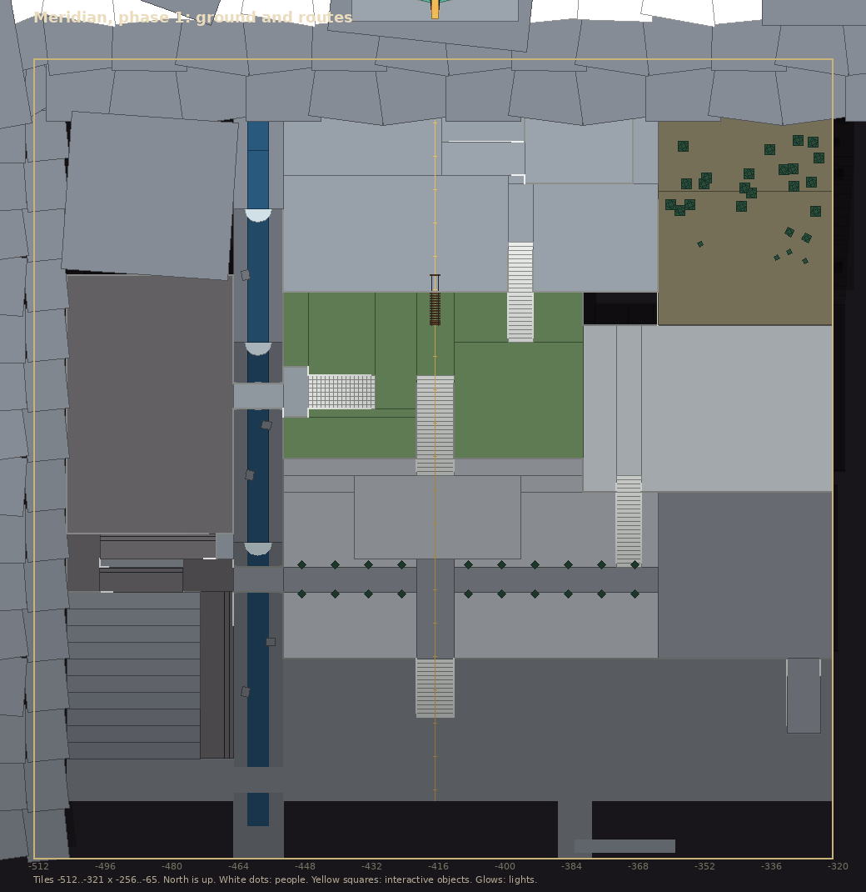
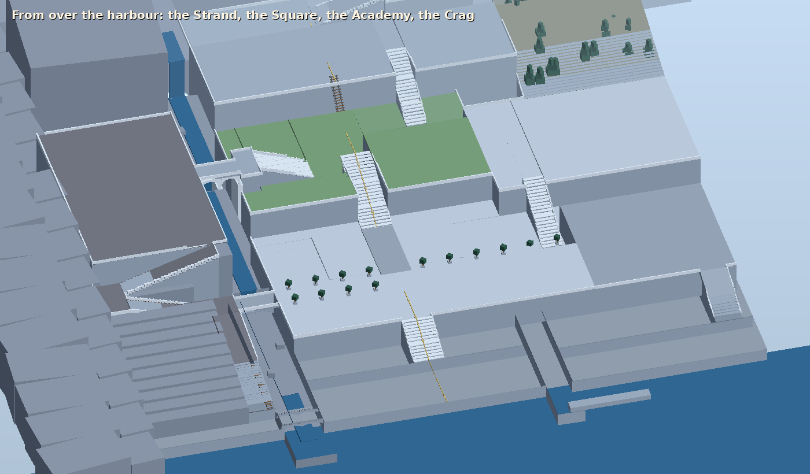
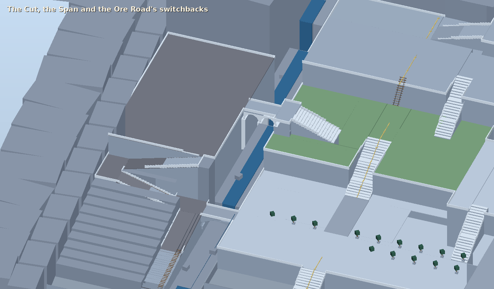

# Meridian: redesign brief (game scale, not lore scale)

For whoever builds `MeridianBuilder` next. This replaces the layout in [meridian.md](meridian.md);
keep reading that for the mood and the asset notes, which still stand. Written 2026-10-21 after
a walk through the first blockout.

## 1. What was wrong

The first blockout built the city the lore describes: a dense grid of identical terraces round a
few civic halls, every street straight, no wall. As a *place to play* it fails in five ways:

1. **Crowded.** 33 closed row houses and four Academy ranges fill the space between the
   landmarks. In a top-down point-and-click game that is a wall of roofs: the camera sees
   buildings, not places.
2. **Closed.** Most buildings cannot be entered. A sandbox needs doors that open. A closed
   building is dead space the player walks round.
3. **Empty.** About 30 townsfolk who say nothing and no stations, shops or nodes. Nothing to do.
4. **Flat.** The brief said "where the range comes down to the sea", but the ground is flat.
   The mountain is a backdrop and the Orrery is a picture.
5. **Wrong scale.** Lore scale says a capital is huge. Game scale says a player crosses a
   city in 30 to 60 seconds and passes something worth stopping for every 15 tiles or so.

**Game scale rule.** A RuneScape city has 30 to 40 buildings, all walkable, and every one
of them has a reason to be entered. Meridian aims for the same *count* (about 40), spread over
**more ground and more height** so that it still feels like a great city: size comes from the
climb and the views, not from stuffing in houses. (Cruor, the colossal one, may go beyond 40
when its turn comes.)

## 2. The rules for this city

These are the acceptance rules. A blockout that breaks one is not done.

| Rule | Number |
|---|---|
| Enterable buildings | About 40: 28 unique, plus a row of 12 identical houses (see 5.3). |
| Every building | Has an open door, a walkable interior on every floor, and at least two things to do or see inside (see 7). No locked doors except the story gates listed in 7.4. |
| Buildings' share of walkable ground | At most 25%. The rest is street, stair, terrace, plaza, garden and shore. |
| Streets and stairs | At least 5 tiles wide; plazas at least 20 x 20. A player never squeezes down a 2-tile alley. |
| Gap between buildings | At least 3 tiles, and no dead ends. Every route can be walked as a loop. |
| Buildings' height | Two storeys (about 8 m) except the named landmarks, which may have three. **Every upper floor is walkable** by a stair or ladder that suits the building, and has something in it (6.9). |
| Something every 15 tiles | Walking along any street you pass an NPC, a station, a node, a readable object or a view point at least every 15 tiles. |
| Crossing time | Harbour to the Orrery gate on foot, the long way: under 60 s at run speed (2 tiles a tick, 120 tiles). Region corner to corner: under 100 s. |
| Camera | Nothing may fully block the camera. Retaining walls and cliff faces sit on the *north* side of a terrace only (the camera sits south), buildings on the up-slope side stay under 8 m, and roofs hide when you are inside (the existing roof hider). A terrace must be at least 16 tiles deep so the one behind it stays visible. |
| Sandbox | Every skill and combat style has something to do in or around Meridian (7). No forced route, no forced faction. |

## 3. Height and levels: what the engine allows

Meridian climbs a mountain (**height**) and its buildings have upper floors, galleries and towers
(**levels**). Both are needed, and both need a small feature first.

### 3.1 What exists today

- **The server and `/shared` already know planes.** `WorldMap` holds up to 4 planes (0-3); the
  pathfinder, line of sight, entities, ground items and object actions all carry a plane, and
  the protocol sends it. A second floor needs no new server rules, only data and one action.
- **The server is flat in height**, and stays so: walking a ramp is walking tiles, as in
  RuneScape. Height is only how it *looks*.
- **The client draws no height and no levels.** `TileMath.Center` returns y = 0 and `EntityView`
  moves every character along y = 0 (`client/Assets/Scripts/TileMath.cs:9`, `EntityView.cs`);
  object actions are sent with `Plane = 0` (`GameSession.cs:653`); nothing hides an upper floor.
- **The exporter writes one plane per region** (`MapArea.plane`, "only plane 0 is used until
  there are buildings with upstairs") and calls a tile walkable if *any* ground collider is under
  it (`MapExporter.MarkMissingGround`), so stacked surfaces collapse into one.
- **Nothing moves a player between planes.** Object actions with a destination exist (the
  shortcuts of `docs/skills.md` 2.8) but only within a plane.

### 3.2 The feature to build first: height and levels

Four small pieces, all outside the game rules:

| Piece | What |
|---|---|
| **Ground snap** | On each step the client casts a ray down onto the ground colliders **of the entity's level** (cached per tile, smoothed along the step); the camera, hit effects, projectiles and ground items follow. |
| **`MapLevel` marker** (map tools) | A component on a floor, wall set or blocker that says "this is level 0 / 1 / 2 / 3". The exporter writes one plane per level: ground, walls and blockers under a `MapLevel` go on its plane, walkable only where that level has a floor collider. Everything unmarked is level 0. |
| **`climb` object action** | A stair, ladder or trapdoor is an object with a `climb` action and a destination `(plane, tile)`: the player walks beside it, then appears on the other floor (the client eases the height). Two-way, one object per end, no code beyond one `ObjectSystem` handler. |
| **Level display** | The client hides geometry of every level **above** the player's plane (floors, walls, roofs), and the existing roof hider handles the rest; clicks only hit colliders of the player's level; entities on other levels are not drawn. |

**Built (2026-10-22).** All four pieces exist; `::tele leveltest` (the scene `LevelTest.unity`, built
by **R'th > Dev > Rebuild Level Test Scene** from `LevelTestBuilder`) is a small region with a stair
hill, a ramp, a two-storey hut and a ladder to a lookout, and the pattern to copy. What the
builder needs to know:

- **Ground at height is just a collider at that height**, but the exporter ignores height, so every
  cliff edge, stair side and terrace edge needs a `MapWall` (the test hill shows how); a tile
  beside a drop that has neither is walkable on the server, and the player would hop the cliff.
- **A floor is a `MapLevel` group**: a slab (the floor collider), its `MapWall`s, blockers, objects
  and creature spawns. `hiddenFromBelow` (the default) switches it off while the player is below;
  turn it off for outer walls and open decks that must always show. A building is therefore
  usually three groups: the ground floor, an "upper walls" shell that always shows, and an
  "upper floor" with the slab and furniture.
- **Stairs and ladders** are objects (`stairs_up`, `stairs_down`, `ladder_up`, `ladder_down`) with a
  collider and a `climbTo` landing; one object at each end. The exporter warns about a landing
  that is blocked.
- **Only the player's own floor can be clicked**, and people on other floors are not seen (so a
  gallery over a hall does not show the hall's visitors; keep that in mind for the Concord).
- **Preview**: **R'th > Show Next Collision Level** cycles the collision preview through the floors.

### 3.3 Design rules that follow

- **Up to four levels** on any tile column (0-3): a ground floor, two upper floors, a roof walk.
  Most buildings use two. Towers and the Orrery gate lodge may use three.
- **Terraces are plane 0 at different heights.** A tier of the city is *not* a level; levels are
  for things standing on top of the ground at that tile (upper floors, galleries, bridges over a
  street, tower rooms).
- **Underground is a separate area.** There is no plane below the ground, so a cellar, cave,
  mine or dungeon is its own small region (its own scene, `MapArea` and export), entered and left
  by a `climb` object whose landing is a tile in that other region (a trapdoor, a stair down, a
  cave mouth). The destination can be any tile in any region, so this needs nothing new. **Where
  it lives:** the same x as the surface place and **1024 tiles further north** (a cellar under
  (-450, -200) is at (-450, 824)), zone-aligned, `instanced` (off the world map), with
  `ownAtmosphere` for its own dark and fog. Each underground area is its own pass, built after
  the surface above it.
- **Every level has its own floor and walls.** A walkable upper floor needs a floor collider on
  its level and walls on that level's plane; its stair or ladder has a landing of at least 2 x 2
  open tiles on each end.
- **A bridge over walkable ground is level 1** (the Span crosses a void and stays level 0 at its
  height; a footbridge over Line Street would be level 1).
- **Slopes:** a walkable ramp climbs at most 1 m per 3 tiles; anything steeper is a stair of shallow
  steps with landings, or a cliff (no ground, or a `MapBlocker`). The exporter does not check
  gradient, so the builder must.
- **The mountain, the far cliffs and the sea are scenery** with no ground colliders, as now.

### 3.4 What this allows

| Want | Possible once 3.2 exists? |
|---|---|
| Terraces at different heights, stairs and ramps between them | Yes. |
| A viaduct over a gorge or the sea | Yes: the deck is ground, the void under it has none. |
| Two-storey houses, galleries, mezzanines, tower rooms, a ladder to a dome | **Yes** (levels 1-3). |
| A footbridge over a street, an arcade with a walk on top | Yes (level 1). |
| A funicular ride | The stations and car yes; the ride itself needs the teleport-style action and the client's long-jump handling (`CLAUDE.md`, "not yet"). A stair also reaches the top, so the ride is a follow-up (9.2). |

## 4. The shape of the city

**The region grows from 144 x 144 to 192 x 192 tiles** (tiles -512..-321 by -256..-65, still
zone-aligned, still clear of every neighbour). Its south-west corner stays put.

Meridian is a city of **five tiers** climbing a mountain from the sea. Each tier is a district
with one job; every tier has two or more ways up, so no climb is forced and routes form loops.

```
 z 192  ┌──────────────────────────────────────────────────────────────┐
        │  ░░ mountain, snow, backdrop ░░          THE ORRERY (own      │  +45 m
 z 150  │      ░░░░░░  Orrery Gate ▲ ◄ funicular top    region later)   │
        │   Observers' Walk  ▲  CRAG  (+30 m)     ░░ pine slope ░░     │
 z 132  │ ~~~~~~~~~~ ▲ ~~~~~~~ Almanac shoulder (+24) ~~~~~~~~~~~~~~~~~ │
        │  UNDERGATE      ║ GORGE ║   ACADEMY TERRACES (+14 m)   FORUM  │  +14 m
        │  HEIGHTS (+20)  ╟ Span ═╢   campus · library · garden  TERRACE│
 z  96  │  Undergate,     ║  the  ║ ═══ Line Street stair ═══   Concord │
        │  Bore Nine,     ║ Cut,  ║                              + Butts│
        │  Trading Hall   ║ falls ║   THE ROWS (+5)  SQUARE (+5)  THE   │  +5 m
 z  52  │  ore road ──────╨ bridge╨── West Row · Gnomon · East Row  Pass │
        │  switchback to the quay          Harbour Stair ▲        road→ │
 z  28  │ ░ sea cliff  THE STRAND (0 m): quay, market, boatyard, inn  ◄ │  0 m
 z   0  └─ sea ────────────────────────────────────────────────────────┘
         x 0                          x 96 (the meridian)             x 192
```

### 4.1 The spine: the meridian

The brass line (the best idea in the first blockout) now runs **up the whole mountain** on the
region's centre line, x = 96.5: set into the quay, the Harbour Stair, Meridian Square (the
gnomon sits on it), the Line Street stair, the Academy Terraces, the funicular, the Crag and the
Orrery Gate. From the harbour it points at the Orrery all the way up, and you can follow it. It
is the one straight line in a city whose other streets bend with the slope.

### 4.2 The tiers

| Tier | Height | Jobs | Boundary |
|---|---|---|---|
| **The Strand** (z 0-48) | 0 m | Harbour, fish and goods, the sea's trade, sailors. | The quay edge to the south, the Harbour Stair (a broad stair of 8 flights, 5 m) to the north. |
| **Meridian Square and the Rows** (z 52-92) | +5 m | The civic heart: the gnomon, the Hall of Measures, shops and the row houses. | Retaining wall and the Line Street stair (9 m over 24 tiles) to the north. |
| **The Academy Terraces** (z 96-132) | +14 m | Scholars, the library and gardens; the foot of the funicular. | Cliff to the north, a gorge to the west, a promontory arcade to the east. |
| **The Crag** (z 132-172) | +24 to +30 m | The Almanac Office on its shoulder, the Observers' Walk (a belvedere path), the funicular's top station and the Orrery Gate. | Mountain above (scenery). The Orrery itself stays a backdrop and later gets its own region. |
| **Undergate Heights** (west, x 8-52, z 76-132) | +20 m | The dwarves' mountain door, trading hall, the survey camp and Bore Nine. | The Gorge to the east (the Span crosses it); the Ore Road winds down the cliff to the quay. |

Two further places complete the ring: **the Forum Terrace** on a promontory in the north-east
at +14 m (the Concord and the Butts side by side, as in the concept art, `images/meridian.png`),
and **the Pass Road** gate in the east at the +5 m level (the toll and the beacon road to
Lucern). Both are reached from the lower tiers by stairs and arcades.

### 4.3 The connectors (these are the fun part)

| Connector | Joins | Notes |
|---|---|---|
| **Harbour Stair** | Strand to Square | Wide stair on the meridian, with a fountain landing halfway. |
| **Line Street stair** | Square to Academy | The processional climb, flights with landings and benches; a view of the harbour from the top landing. |
| **The Cut and its bridges** | West and east of the gorge | A mountain stream falls through the Gorge to the sea. **A low bridge** on the Parallel (+5 m) and **the Span** (+20 m), a tall arched viaduct across the gorge to Undergate Heights. The Span is the money shot: you walk across a long deck over a drop with the whole city behind you. |
| **The Ore Road** | Undergate Heights to the quay | A switchback road down the cliff with the dwarves' cart-line beside it: ore carts, a lamp-post at each bend. The route a miner takes. |
| **The Arcade Stair** | East Row to the Forum Terrace | A stair under a run of arches on the terrace's side. |
| **The funicular** | Academy foot to the Crag | The car on its rails, a shortcut and a view (9.2). |
| **Shortcuts** (skill-gated, `docs/skills.md` 2.8) | see 7.4 | Each is an object action with a requirement and a destination. |

## 5. What stays, what goes, what is new

### 5.1 Keep (the first blockout got these right)

The brass meridian; the gnomon with its hour-stones and the Little Orrery with its green cracked
moon; the Concord with its portico, dome, arcs of benches and rostrum (**the auditorium**); the
Butts with its firing line, lanes and targets (**the range**); the moon fragment behind its
rail; the standards case and the Exchequer's counter; the almanac board with its "revised
upward"; the funicular; the harbour beacon and the pass beacons; Bore Nine with its glowing spoil,
cart-line and ore carts; the Undergate; the toll board; the clipped trees in tubs on the Parallel
and the domed rooftop observatories as the Rows' only copper. The existing
[asset list](meridian-assets.md) still names them all.

### 5.2 Cut or shrink

| Was | Becomes |
|---|---|
| 33 solid row houses in a block grid | 12 enterable houses in two Rows with gardens and steps between them (5.3). |
| The Academy as four ranges round a court (32 tiles square) | A **campus** of separate buildings round lawns (6.4). |
| A 132-tile quay with five warehouses | A shorter quay, two open warehouses and a market. |
| The Hall of Measures, Almanac Office and Concord all on one flat plan | Spread over three tiers (Square, Crag, Forum Terrace). |
| Streets laid out as a grid | A few straight spines (the meridian, the Parallel, Line Street) plus streets that bend with the terrace. |

### 5.3 The Rows (the lore, as a joke the player can find)

Concordia builds every house identically, so one interior serves twelve houses: build **one house
template** (a ground-floor room with a hearth and table, a stair up to a bedroom) and place it twelve
times in two Rows of six, west and east of the Square. They differ only by the **resident** and
a brass number plate. Most residents are short chatters and a few carry a small errand;
**No. 7** is different inside (that is the secret in 8.3). Gardens and a back lane keep the Rows
open: three-tile gaps, trees in tubs, benches.

## 6. The districts in full

Coordinates are local (add -512, -256 for world tiles) and approximate; the builder should
adjust to the ground. "Station" and "node" mean the existing mechanisms in `CLAUDE.md`
("Extending the server"): stations are an object with a `process` action, nodes are `node` on an
object type, shops, banks and task-givers are NPC actions. Recipes and item lists come later;
this brief only says **what is in the room**.

### 6.1 The Strand (0 m, z 0-48)

The sea trade and the city's cheap, loud ground floor. Gulls, rope, brine, the moon's tide.

| Place | Size | Inside / around |
|---|---|---|
| **The quay** and the **harbour beacon** | quay 80 x 24; beacon tower with a walkable base | Bollards, a crane (winch you can use), two moored traders and the fishing boats; **fishing spots** off the quay's end. |
| **Fish Market** (open hall on posts) | 16 x 12 | Stalls, a **shop** (fish, nets), a fishmonger who buys catches; a **cooking range**. |
| **Harbourmaster's Office** | 10 x 10 | **Task-giver** (ferry and ship errands), a shipping board (readable), the harbourmaster's log. |
| **The Plumb Line** (inn) | 16 x 14 | The tavern: a hearth, a **cooking range**, a barometer and a bar; patrons with rumours. The only place in the city with a fire that is not measured. |
| **Net Loft and Boatyard** | 14 x 12 | An **Artifice workbench** for fishing gear (rods, nets, traps), a keel on stocks, a **Tailoring loft** (sailcloth, pale wool). |
| **Chandlery** | 10 x 10 | A general **shop**: tools, lamp oil. Upstairs lodging for an occultist in hiding (secret, 8.3). |
| **Stevedores' Hall and cold cellar** | 14 x 12 | Two open warehouse bays; a **Butchering cold cellar** (station) for Moonborn carcasses; ledger on the wall. |
| **Sailors' Shrine** | 5 x 5 | The one Synod lamp the city tolerates: a **prayer altar** that restores devotion, hidden between warehouses. |

### 6.2 Meridian Square and the Rows (+5 m, z 52-92)

The civic centre of the old blockout, thinned and opened out. The Square is 40 x 30 and
everything faces it.

| Place | Size | Inside / around |
|---|---|---|
| **The gnomon**, hour-stones and the **Little Orrery** | plaza 40 x 30 | The hour-stones are examinable and each gives the real time of day. A plain fountain, benches. |
| **Hall of Measures** | 16 x 14 | The standards case (readable, examine "the Concordian ell"); **bank** (the Exchequer's clerks) with the strongbox; a **task-giver** (measures and tallies). |
| **The Exchange** | 14 x 12 | A **shop** (Concordian goods), a notice board of tasks and one-off errands. |
| **The Instrument Maker** | 12 x 12 | An **Artifice workbench** for crossbows, bolts and sights; the maker sells starting ranged kit. |
| **The Clockmaker** | 10 x 8 | A curio shop and a talking-piece (a chiming clock that gives hints). |
| **The Surveyors' Guild** | 12 x 10 | The map table (the **world map** gets its tutor), quests from the survey office, achievement diary desk. |
| **West Row and East Row** | 6 houses each, 8 x 8 | The identical houses (5.3), with the Parallel passing between. |
| **The Parallel** | z 70, x 40-180 | The east-west avenue lined with tub trees; crosses the Cut on the low bridge to the west, runs east to the Pass Road gate. |

### 6.3 The Forum Terrace (+14 m, north-east promontory, x 132-186, z 88-128)

The concept art's terrace: an amphitheatre and a firing range side by side on arches over the
sea. The best view in the city looking east over the bay.

| Place | Size | Inside / around |
|---|---|---|
| **The Concord** (auditorium) | 26 x 20 | Walk-in, as before: portico, dome, three arcs of benches facing the rostrum; this is where the **assembly** sits (a recurring event, 8.4). The rostrum is usable (a speech action, see 8.2). |
| **The Butts** (the range) | 40 x 30 | The roofed firing line, six lanes and targets: a **Ranged training area** (the targets are attackable training dummies, one per ranged weapon class). |
| **Marksmen's Lodge** | 12 x 10 | A **shop** for ranged ammunition, a task-giver for ranged tasks (calibration), a rack of crossbows to examine. |
| **The judges' stand** | 6 x 6 | Open pavilion above the lanes: the best seat for watching; a sandbox spot for a leaderboard later. |
| **Arcade Stair** | 6 wide | Arches below (over the sea), the rail with telescopes. |

### 6.4 The Academy Terraces (+14 m, z 96-132)

The old four-range block becomes a **campus**: lawns, covered walks, small buildings. Scholars
pace, argue and take notes. The terrace is 70 x 36 and the funicular's lower station is its
north edge.

| Place | Size | Inside / around |
|---|---|---|
| **The Academy Hall** | 18 x 14 | The great hall under a clock. Lectures at fixed hours (NPCs sit); a **quest-giver** (a professor seeking a field assistant). |
| **The Library** | 16 x 14 | Walk-in shelves: **the skill guide** is here in the world (lore books to examine; each lists a skill's unlocks). Bestiary desk. |
| **The Cabinet of Natural Philosophy** | 14 x 12 | A museum: the **moon fragment** behind its rail, the case of moon-glass, a stuffed crag-goat; the first moonfall lore. |
| **Physic Garden and Dispensary** | 18 x 14 | Herb beds (**Foraging nodes**, alpine herbs) and a **Medicine station**; a physician who brews and sells. |
| **Scholars' Lodgings** (two) | 10 x 8 | Small houses: two scholars with chatter and a minor errand each (one has been told the forecast is wrong). |
| **Observatory Row** | three 6 x 6 | Three little observatory towers: a ladder up to the dome room (level 1) and a brass telescope each: **view points**, one with a puzzle (align it to the moon's phase). |
| **The Funicular lower station** | 16 x 12 | The ticket office and the car; see 9.2. |

### 6.5 The Crag (+24 to +30 m, z 132-172)

Quiet, high and exposed: the climb's reward. Cold wind, a sea of roofs below.

| Place | Size | Inside / around |
|---|---|---|
| **Almanac Office** | 16 x 14 | The forecast desk. The **almanac board** outside; a semaphore mast; clerks who read the day's forecast aloud; a task-giver for forecast errands. |
| **Observers' Walk** | a belvedere path, 4 wide, about 60 long | A series of **telescope view points** (each a one-off examinable, some with a lore line); a bench; the Little Orrery's twin in miniature. |
| **The beacon tower** (the first) | tower base 8 x 8, +30 m | A walkable base; the lamp lit by night. The start of the Lucern beacon road. |
| **The funicular upper station** | 14 x 10 | The car arrives here; the brass winding wheel through its glass wall. |
| **The Orrery Gate** | a lodge 12 x 10 | A locked gate, **ascents by appointment**: the flag `orrery_gate_open` is for Magister Varrow's first quest (not built). Her assistant stands here. |
| **The Orrery** | scenery | Backdrop at the end of the meridian: its own region later. |

### 6.6 Undergate Heights (+20 m, west, x 8-52, z 76-132)

The dwarves' foothold on the surface: heavy, dark, bronze-banded stone against the pale ashlar of
the Concord. The Under-Treaty in architecture.

| Place | Size | Inside / around |
|---|---|---|
| **The Undergate** | portal hall 14 x 12 | A walk-in portal into the mountain (the rails run in). Sealed past the first chamber until the deep story (flag). A **bank chest** inside the doorway (the dwarves' stockroom). |
| **Dwarven Trading Hall** | 16 x 14 | Battlemented, built to keep out more than weather. A **shop** (frostiron goods, tools), a dwarven trader who haggles in dialogue. |
| **Smeltery and forge-yard** | 16 x 14 | A **furnace and anvil** (Smithing stations); ore carts rolling in; a smith NPC. |
| **Cart-master's Office** | 10 x 8 | The cart-line's timetable; Brannoch's agent (a **task-giver** for deep creatures later). The cart ride to Frostpeak Forge starts here (a future connection). |
| **Survey Office and camp** | office 12 x 10, tents | The surveyors' notice, crates of glowing cores; a **quest-giver** (a missing survey team). |
| **Bore Nine** | derrick 12 x 12, fenced | The suspended bore with its glowing spoil. **Sealed for now**; its shaft later leads down. A surveyor on watch. |
| **The Cutting** (mining) | 30 x 20 | **Mining nodes**: low-tier ore in the road cutting, **frostiron** at the end of the heights. |

### 6.7 The Pass Road gate (+5 m, east, x 150-190, z 52-100)

The way in from the east (Sere and Lucern Pass): the first thing a visitor from the world sees.

| Place | Size | Inside / around |
|---|---|---|
| **The toll** | house 10 x 8, bar | The raised toll bar, the toll board (readable), a toll clerk (a **task-giver**: escorts and tolls). |
| **Wayhouse and Stables** | 16 x 14 | A waiting inn for travellers: hearth, stable, a **bank chest** for carters. |
| **Cartwrights' Yard** | 14 x 12 | Wheels and axles to examine; a shortcut gate to the Cutting (7.4). |
| **Beacon tower (east)** | tower base 8 x 8 | The first of the lamp towers up the pass; walkable base. |
| **Pine slope** (woodcutting) | 40 x 30 | **Woodcutting nodes** (pale pine) on the slopes north of the road. |

### 6.8 The outskirts

A ring of walkable but sparse ground (rocky slope, pines, scree, the shore) where **creatures
live**: low-level wildlife on the pine slope and scree (crag goats and gulls, the Wildlife
family), a pair of Moonborn at the cliff tops (higher, optional, a taste of the Moonborn family
for Butchering). They are the Melee, Defence and Occultism training around the city; the
first designs are in `docs/skills.md` section 5 when their turn comes.

### 6.9 Upper floors

Every building with a second floor has a way up that suits it, and something worth the climb.
Levels are 1-3 (3.3); a tower may use all three.

| Building | Way up | What's on the upper floor |
|---|---|---|
| **Harbour beacon**, **beacon towers** (three) | a spiral stair inside | Three levels to the lamp room (level 3): a telescope and the lamp-keeper; the view over the bay or the pass. |
| **Plumb Line** | a stair from the bar | Rooms to let: a bed to rest in, a lodger with a quest, a balcony over the quay. |
| **Chandlery** | a narrow stair | The hiding occultist's room (a secret, 8.3). |
| **Harbourmaster's Office** | a stair | The shipping chart room: a map table and the log. |
| **Stevedores' Hall** | a ladder to a loft | The loft: crates, a lookout window, a small hoard. |
| **Hall of Measures** | a stair | The Exchequer's gallery over the counter, and the vault door (locked, a quest). |
| **Surveyors' Guild** | a stair | The map room and the achievement diary desk. |
| **The Rows** (twelve houses) | a stair | A bedroom, identical in all but No. 7, which is not. |
| **The Concord** | side stairs | A **gallery** of benches round the hall, the best seats in the city for the assembly. |
| **Marksmen's Lodge** | a stair | The range office and a balcony over the lanes. |
| **Judges' stand** | a ladder | A platform above the lanes: the best view of the Butts. |
| **Academy Hall** | a stair | The lecture gallery; a locked professor's study (a quest). |
| **Library** | a stair and a gallery | A mezzanine of shelves: a reading desk and the forbidden shelf (a secret). |
| **Cabinet of Natural Philosophy** | a stair | The upper gallery of specimens and the moon-glass case. |
| **Scholars' Lodgings** (two) | a stair | A study with books to read. |
| **Observatory Row** (three) | a ladder to the dome room | The brass telescope under a dome slit: a view point, one with the moon puzzle. |
| **Almanac Office** | a stair, then a ladder | The forecast desk upstairs and, above it, the semaphore room under the mast. |
| **Orrery Gate lodge** | a stair | The appointment office and a view of the Orrery. |
| **Trading Hall** | a stair | The dwarves' counting room. |
| **Survey Office** | a stair | The map table and the core store. |
| **Toll-house** | a ladder | The bell loft over the road. |
| **Wayhouse** | a stair | Rooms to let and a quiet table. |

Buildings not listed (open pavilions, the Smeltery, the Sailors' Shrine, the Undergate hall) are
one level.

### 6.10 Underground (separate areas, built after the surface)

Entrances are placed with the surface; the areas behind them are separate passes. Skeleton only.

| Area | Entered from | What it is |
|---|---|---|
| **The Undergate's first chamber and the cart tunnels** | the Undergate hall | The dwarves' lamplit halls: the cart-line runs in, a trading post, rock to mine; sealed past the first chamber until the deep story. |
| **Bore Nine's shaft** | the derrick | The suspended bore, spoil glowing green: the deep story's way down. |
| **The Exchequer's strongroom** | the Hall of Measures (gallery) | Vault of the standards and the city's coin; a quest. |
| **The smugglers' cellars and sea caves** | the Stevedores' Hall and the quay cliffs | Cellars under the Strand's warehouses opening onto sea caves: contraband, the Sailors' Shrine's older cousin, low-level creatures. |
| **The Academy's cold archive** | the Library's forbidden shelf | Cold stacks under the Library: moon-glass cases, the Cabinet's reserve collection, a secret. |
| **A moonfall crater** | the outskirts | An event area (docs/skills.md: Moonborn), later. |

## 7. Content: what Meridian offers

### 7.1 Per skill

| Skill | In Meridian |
|---|---|
| Ranged | The Butts (targets) and the Marksmen's Lodge (shop, tasks). |
| Artifice | Workbenches at the Instrument Maker (crossbows) and Net Loft (fishing gear). |
| Fishing | The quay, the Cut's pool (freshwater spots), the Sailors' Shrine's corner. |
| Mining | The Cutting: low ore by the road, frostiron on Undergate Heights (needs a high level; the dwarves must trust you). |
| Woodcutting | The pine slope: pale pine. |
| Smithing | The Smeltery and forge-yard. |
| Cooking | Ranges at the Plumb Line and the Fish Market. |
| Medicine / Foraging | The Physic Garden and Dispensary: alpine herb beds and a station. |
| Tailoring | The Net Loft's sail-loft (cloth, pale wool). |
| Butchering | The cold cellar (Moonborn) and the outskirts' wildlife. |
| Religion | The Sailors' Shrine: an altar, tolerated. The Rationalists call religion a fever. |
| Occultism | A hiding occultist above the Chandlery (secret, 8.3), and the rites are shunned here. |
| Melee / Defence | The outskirts; wardens as combat tutors later. |

### 7.2 Per building

Every building (and every floor worth the climb) has two or more of: an NPC with a **dialogue** (not just a name); a **station**,
**shop**, **bank** or **task-giver**; a **gather node**; a **readable** (an object action with a
`message`, the existing sign mechanism); a **secret** or a **view point**. The tables in 6 give
the minimum; if a building ends up with less, it gets a resident with a conversation.

### 7.3 NPC roster (the skeleton)

About 70, spread so that no street is empty and no building has fewer than one resident. Roles,
not names, for now (names come with their dialogue): Concord wardens (patrolling the Square and
the Parallel), almanac clerks, scholars (a dozen across the campus), marksmen and a range
master, harbourmaster, fishers and sailors, stevedores, the Rows' residents (12), the physician,
the instrument maker and a clockmaker, dwarven carters, a trader and a smith, surveyors, the
toll clerk, travellers at the Wayhouse. **Magister Ilse Varrow** is placed later, at the Orrery
Gate, with her first quest.

### 7.4 Gates and shortcuts

| Gate | Needs | Where |
|---|---|---|
| The Orrery Gate | the flag `orrery_gate_open` (quest) | Crag |
| The Undergate's inner door | a deep-story flag | Undergate Heights |
| Bore Nine's shaft | a quest flag | Undergate Heights |
| A rubble pile on the Ore Road short-cut | Mining level | Ore Road |
| A thicket from the Pine slope to the Crag | Woodcutting level | Pass Road to the Crag |
| A jammed gate on the Cutting's gate to the survey camp | Defence level | Undergate Heights |
| A ford over the Cut above the falls | Fishing level | the Gorge |

## 8. Story and secrets (skeleton, for the builder to leave room for)

### 8.1 The lore the city must carry

Meridian is where the Rationalists show their order and hide their guilt: the beacons, the
forecasts, the measures are all true and all a veneer over the **deep bores**. The player should
see the veneer first and the crack second.

### 8.2 The cracks, placed in the city

- The almanac's forecast with a line struck through, "revised upward" (Almanac Office board).
- A moon fragment glowing green in the Cabinet, with a clerk who counts the visitors.
- Bore Nine, fenced and silent, its spoil glowing, and a surveyor who will not talk about the
  team that went down.
- The dwarves' trade hall, whose carters grumble about the Under-Treaty's last clause.
- The **Concord's assembly**: a recurring scene (an event, not a placed building) where
  scholars debate the forecast. The player can sit, listen and later speak.

### 8.3 Secrets (for sandbox reward)

No. 7, a row house that is not identical inside (a room under the stairs); the occultist above the
Chandlery; a hidden shrine; the Observatory Row puzzle; a perch on the Observers' Walk with a view
of the Pass; a loose paving stone on the meridian where the brass line has a seam.

### 8.4 Quest hooks (the lore's own)

1. **The forecast** (Varrow's patronage): confirm a moonfall by visiting the beacons and the
   observatories. Starts at the Almanac Office; a path across the whole city.
2. **The missing survey team** (the deep story): starts at the Survey Office; ends at Bore Nine.
3. **A scholar's field assistant**: the Academy; an easy first errand for the Library.
4. **The Rows' errand chain**: No. 7 is the end of a chain of small favours for the neighbours.
5. **The Moonborn task** (Butchering): the cold cellar's first task-giver.

## 9. What the builder has to do

### 9.1 Phases (each ends with a walk-through)

| Phase | Content | Done when |
|---|---|---|
| **0. Height and levels** (done) | The feature in 3.2: ground snap, `MapLevel`, the `climb` action, level display. | A test scene with a slope and a two-storey hut: you walk up the slope, climb the ladder, see the upper floor, and clicks, camera and the collision preview work on both levels. |
| **1. Terrain and routes** (built, see 9.4) | The five tiers, retaining walls, stairs, ramps, the Cut and its bridges, the Span, the Ore Road. **No buildings.** | You can walk every loop and see the next tier from each; nothing exports as walkable that should not (check the collision preview). |
| **2. Landmarks and building shells** | Every building in 6 as an enterable shell with its door, floors, stairs and roof (hideable); the Rows from one template. | Every building can be entered; the building count and 25% rule hold. |
| **3. Interiors and objects** | Stations, shops' counters, benches, readables, view points, nodes, gates. | The "every 15 tiles" rule holds on every route. |
| **4. Placement and data** | NPCs, their dialogue, shops, stations and nodes in the content files, region data. | Every building has what 7.2 says. |

Dividing 4 by system keeps each reviewable: NPC placement first, then shops and banks, then
stations and nodes, then dialogue and quests.

### 9.2 New pieces for `WorldKit`

| Piece | Used for |
|---|---|
| `Terrace(rect, height)` and `Retain(...)` | A flat tier with a retaining wall on its north edge. |
| `Stair(from, to, width, landings)` and `Ramp(...)` | The connectors; checks the gradient rule. |
| `Viaduct(from, to, deck, arches)` | The Span and the Arcade Stair: a deck over a void with arches below. |
| `Stream(path, falls)` | The Cut and its falls (water blocks walking, fords and bridges cross it). |
| `Pavilion(rect, roof)` | Open halls on posts (the market, the judges' stand). |
| `House(template)` | The one identical house, placed twelve times. |
| `Interior` helpers | A counter, a shelf, a workbench, a hearth, benches, a dais: so every building gets furniture without hand-placing it. |
| `Backdrop(...)` | Distant buildings across the gorge: silhouettes with no ground, never walkable. |

Built in phase 1: `Terrace`, `Retain`, `Stair` and `Ramp` became one `Terraces` map (it places the
retaining walls itself), plus `Viaduct` and `Stream`. The rest come with phase 2.

**The funicular.** Build both stations, the rails and the car. The ride itself (the car moves,
the player is carried to the other station) needs an object action and the client's long-jump
handling; plan it as a follow-up and let the stair be the route in the meantime.

### 9.3 Region data

`Meridian` becomes 192 x 192 at (-512, -256). Update `docs/world-map.md`'s region table (to
-512..-321, -256..-65) when the scene is rebuilt. Keep the atmosphere and the `meridian` music
track. The Orrery stays scenery.

### 9.4 Phase 1 as built

`MeridianBuilder` now builds the ground and the routes only (the first blockout's buildings are
gone until phase 2; its code is in git history, and `meridian-assets.md` keeps the old list until
the scene is rebuilt). The ground is a `Terraces` map (`WorldKit.Terraces.cs`): terraces, stairs,
ramps and bridge decks described tile by tile, built as solid blocks, with a `MapWall` drawn as a
kerb or parapet on every drop of more than 0.5 m and wherever high ground falls into nothing. It
warns about a step over 0.5 m or a ramp steeper than 1 in 3. A headless check of the builder
finds every open tile reachable from the quay and no drop without a wall.



Local coordinates (add -512, -256 for world tiles):

| Ground | Height | Tiles |
|---|---|---|
| The Strand (quay), the west quay, the mole | 0 m | x 60-191, z 14-47; x 8-47, z 14-23; x 126-133, z 0-13 |
| Meridian Square and the Rows; the Pass Road's ground | +5 | x 60-149, z 48-95; x 150-191, z 48-87 |
| The Academy Terraces; the Forum Terrace | +14 | x 60-131, z 96-135; x 132-191, z 88-127 |
| Undergate Heights; the Span Head | +20 | x 8-47, z 78-139; x 60-65, z 106-117 |
| The Crag; the pine slope's top | +24 | x 60-149, z 136-177; x 150-191, z 160-177 |
| The knoll (the beacon) | +30 | x 118-143, z 162-177 |
| The Gorge (the Cut) | none | x 48-59, the whole length, but for its three bridges |

| Connector | Joins | Tiles, width |
|---|---|---|
| Harbour Stair | Strand to Square | x 92-100, z 34-47; 9 wide, a landing halfway |
| East Ramp | Strand to the Pass Road | x 181-188, z 30-47; 8 wide |
| Line Street stair | Square to Academy | x 92-100, z 92-115; 9 wide, two landings |
| Arcade Stair | Square (east) to the Forum Terrace | x 140-145, z 70-91; 6 wide, a landing |
| Span Head stair | Academy to the Span Head | x 66-81, z 108-115; 8 wide |
| Crag stair | Academy to the Crag | x 114-119, z 124-147; 6 wide, two landings |
| Knoll ramp | Crag to the knoll | x 98-117, z 164-171; 8 wide |
| Pine slope | Forum Terrace to the Crag's east end | x 150-191, z 128-159; a 42-wide ramp through the pines |
| The Ore Road | west quay to the low bridge (+5) to the Heights (+20) | three ramps: x 40-47 z 24-63; x 16-35 z 64-69; x 16-43 z 72-77 |
| Harbour bridge, low bridge, the Span | across the Cut at 0, +5 and +20 | z 16-21, z 64-69 (the Parallel), z 108-113 |

The meridian's brass line runs up every stair from the quay to the Crag; the funicular's rails
climb the Crag's face on it. The Orrery stands on its own peak behind the city.





## 10. Decisions I made, and what I need

**Made (say if you disagree):** the region grows to 192 x 192; the Concord moves to the Forum
Terrace beside the Butts, as in the concept art; the Orrery stays a backdrop; the funicular ride
is a follow-up; the Rows are twelve identical enterable houses; Religion gets one tolerated
altar; Bore Nine is sealed; **buildings have walkable upper floors** (you asked for this), so
levels are part of Phase 0.

**Needed from you:**
1. **The Moonborn cold cellar** (Butchering): placed in the Stevedores' Hall as a station unless
   you say otherwise; the task-giver waits for a crater camp.
2. **Underground area convention** (3.3, 6.10): same x as the surface and 1024 tiles further north. Fine, or do you want another convention?
