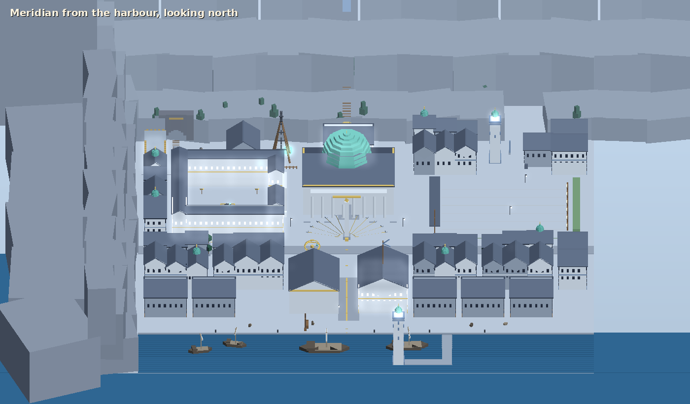
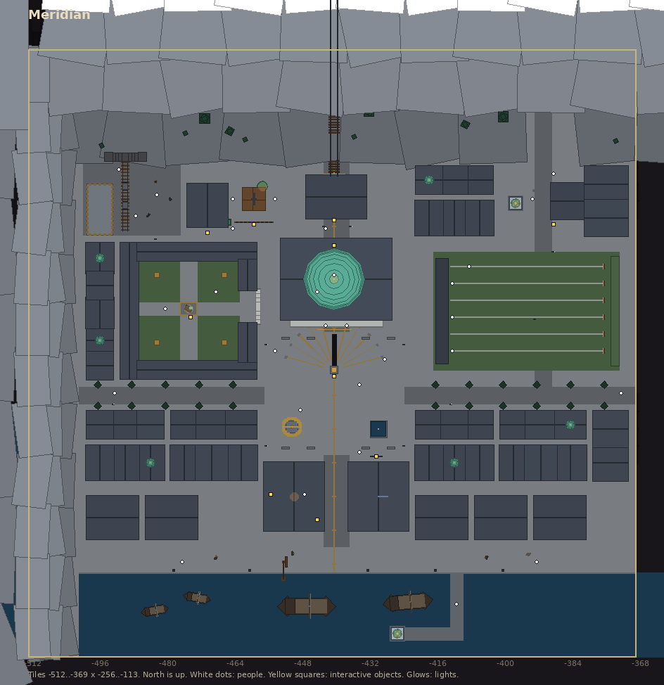
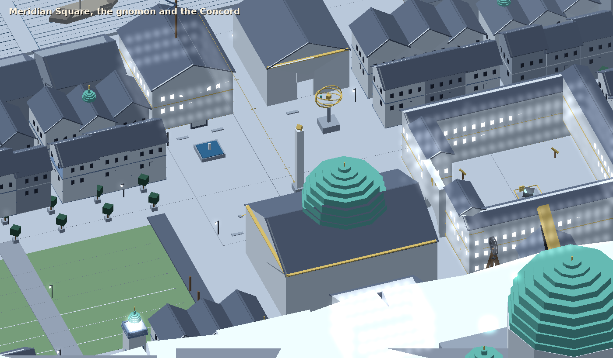
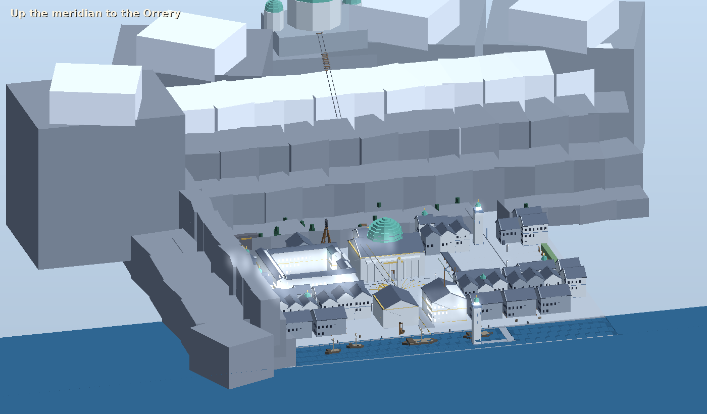
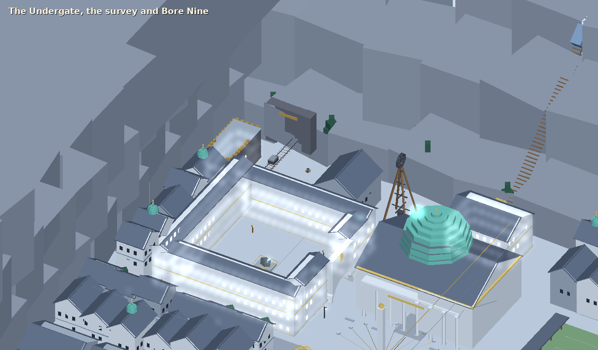

# Meridian

> **Superseded layout:** the first blockout below was too crowded, closed and empty. The next
> pass follows [meridian-redesign.md](meridian-redesign.md); the mood and asset notes here still
> stand.

The capital of Concordia, the Rationalists, "where the range comes down to the sea"
(`docs/world-map.md`). Concordia calls itself an agreement, not a nation, and its city is built
like one: a grid, straight streets, everything measured, no wall. Its neutrality is its wall, and
every side needs its roads and its moonfall forecasts (`docs/lore.md`). This is the blockout:
every building, street and landmark at its final size, with placeholder geometry tagged by the
asset it stands for. It is built by `client/Assets/Editor/MeridianBuilder.cs` (**R'th > Dev >
Rebuild Meridian Scene**), which also exports the map and writes
[meridian-assets.md](meridian-assets.md).

The images come from a headless preview of the builder, not from Unity.

## Mood

A clear, cold morning. Grey granite and pale ashlar, slate roofs, blue-grey doors and trim, and
brass on everything that measures. The houses are identical terraces; the only copper is on the
instruments, so the verdigris domes (the Concord, the Orrery, the beacons, the little rooftop
observatories) mark what the city cares about. **The meridian is the city's whole story**: a
brass line set in the paving runs dead straight from the harbour, through the gnomon in the
square and the Concord's aisle, to the funicular that climbs the crag to the Orrery, which is in
sight from everywhere. Underneath the order, the cracks show: a piece of the moon glowing green in
the Academy court, a forecast struck through and "revised upward", and in the corner by the
dwarves' gate a deep bore, suspended, whose spoil glows.

Region atmosphere: a white-blue sun (0.92, 0.96, 1) at 1.25, cool ambient, clean air with fog
(0.72, 0.8, 0.88) only from 60 to 140 tiles. Music track `meridian`.

## Where it is

Tiles -512..-369 x -256..-113 (144 x 144), far to the south-west where Candora meets the sea.
Not joined to the world yet: use `::tele meridian`. The Parallel comes in from the east at about
(-372, -195).

## Layout

Local coordinates (add -512, -256 for world tiles).

| Place | Where | What's there |
|---|---|---|
| The meridian | x 72.5, z 20-118 | A brass strip in the paving, cross-marked every 8 m, down the middle of Line Street (x 70-75). |
| Meridian Square | x 56-88, z 48-76 | The gnomon (a 13 m obelisk; plaque `meridian_gnomon`), hour lines fanning to hour-stones, the Little Orrery (a brass armillary), a plain fountain, benches, lamps. |
| The Concord | x 60-85, z 80-98 | Walk-in: a portico of plain columns, benches in three arcs round the rostrum (`concord_rostrum`) under a verdigris dome with a light shaft. |
| The funicular | x 66-79, z 103-113 | The lower station with its winding wheel; the gate (`orrery_lift`, locked: ascents by appointment); rails and a car up the crag. |
| The Orrery | far behind, on the crag | Scenery only: a drum and a great domed observatory with an open slit and a brass telescope. It gets its own region later. |
| The Academy | x 22-54, z 66-98 | Four ranges round a court with a gate under a clock; in the court, a moon fragment behind a brass rail (`moon_fragment`), telescopes on tripods. |
| The Hall of Measures | x 56-69, z 30-45 | Walk-in: the standards case (`standard_measures`), the Exchequer's counter and its strongbox (`synod_strongbox`, as the city's bank). |
| The Almanac Office | x 76-89, z 30-45 | A semaphore mast on the ridge; outside, the moonfall forecast board (`moonfall_almanac`). |
| The harbour | z 0-37 | Quay, bollards, a crane, warehouses, two traders and fishing boats inside a breakwater with a beacon lighthouse. |
| The Butts | x 96-139, z 68-95 | The shooting ground: a roofed firing line, six lanes, targets against an earth bank. |
| The pass toll | x 114-132, z 102-112 | The pass road north (x 120-123), a raised toll bar, the toll-house, the toll board (`concord_toll_board`) and the first beacon tower. |
| The Undergate | x 13-36, z 100-117 | The dwarves' portal into the mountain, the cart-line and ore carts, their battlemented trading hall, the ore yard. |
| The survey and Bore Nine | x 38-57, z 100-113 | The survey office and its notice (`survey_notice`), crates of glowing cores, the fenced derrick over Bore Nine and its sign (`bore_nine`). |
| The town | everywhere else | Terraced rows of ashlar or granite with slate roofs, some with a small copper observatory; the Parallel (z 60-63) lined with clipped trees in tubs. |
| Outside | | Sea cliffs and headlands to the west; Candora's slope and snow to the north, pines, peaks. |

About 30 townsfolk: Concord wardens, scholars, almanac clerks, marksmen, dwarven carters,
surveyors and fishers. None of them talk yet. Magister Ilse Varrow isn't placed: she belongs in
the Orrery, with her first quest.

## Assets

[meridian-assets.md](meridian-assets.md) lists every stand-in (`meridian/<name>`). The kit grew
three pieces for Concordia: `Ring`, `Armillary` (an armillary sphere with optional moons) and
`Rails` (track on sleepers between any two points, sloped or flat).

## Not yet

The Orrery as a region (and the funicular ride), Magister Varrow and the Academy's people,
dialogue, the Under-Treaty's dwarves as traders, Bore Nine as a place to go down, the beacon road
up the pass to Lucern and Sere, ranged combat at the Butts, music.
