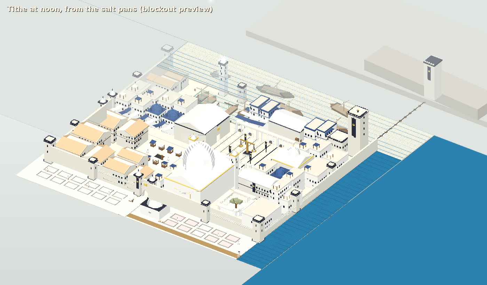
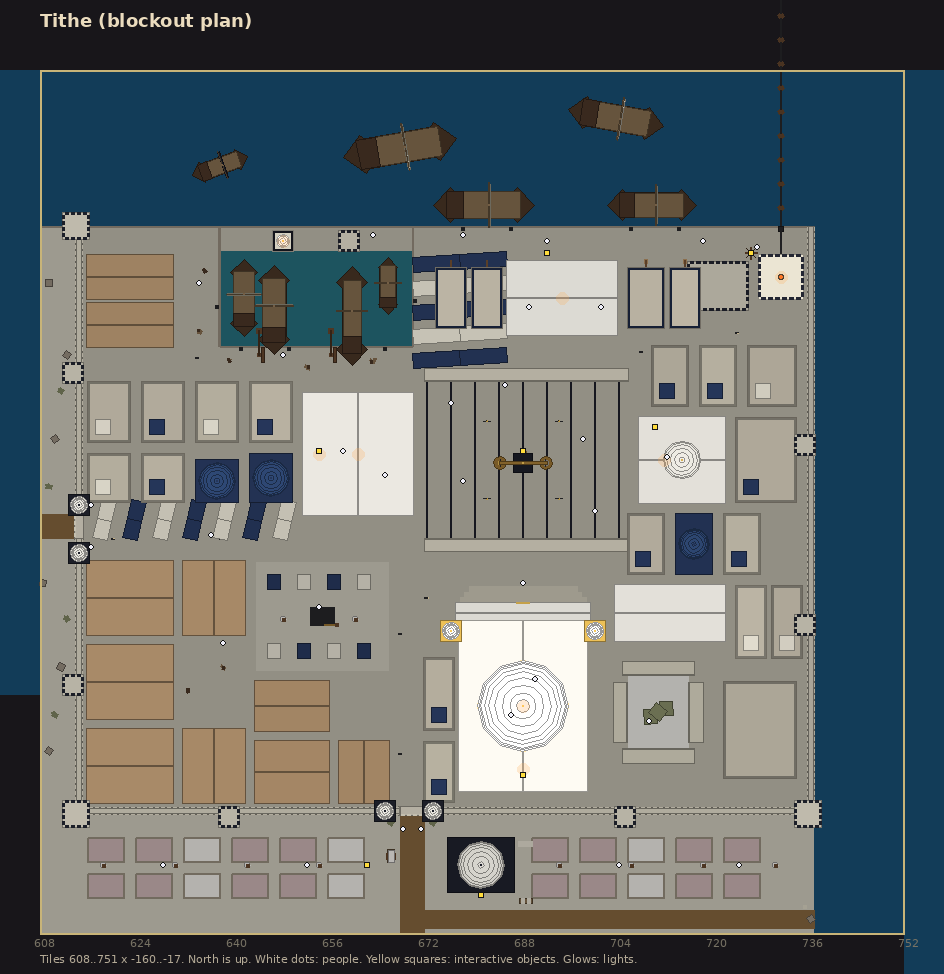
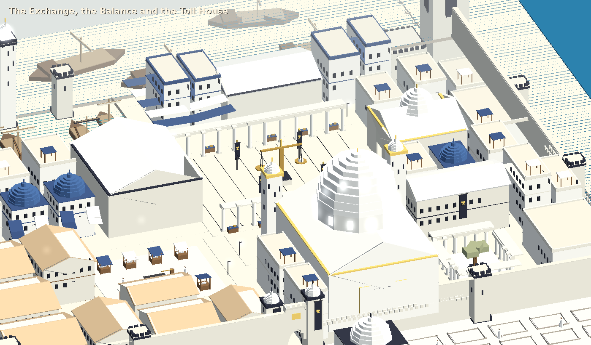

# Tithe

The second see of Blood, the creditor of the basin, and the bay's only door to the sea
(`docs/lore.md`, "Tithe, the creditor see"). This is the blockout: every building, street and
landmark at its final size, with placeholder geometry tagged by the asset it stands for. It is
built by `client/Assets/Editor/TitheBuilder.cs` (**R'th > Dev > Rebuild Tithe Scene**), which
also exports the map and writes [tithe-assets.md](tithe-assets.md), the list of assets to make.

The images come from a headless preview of the builder (flat-shaded boxes in the region's fog
and sun), not from Unity.

## Mood

Noon on the salt coast. A white, high sun; whitewash, salt-stone and white domes; flat roofs
with terraces and awnings; ink-black trim, gold for the scales, ink blue for cloth and the odd
dome; deep blue water on two sides. Shade sails over every street. Almost nothing grows. Where
Cruor is warm, crowded and feverish, Tithe is bright, ordered and quiet: a counting-house that
sings. Its emblem is the **scales**, gold on black, on every banner, gate and pediment.

Region atmosphere: a white sun (1, 0.97, 0.9) at 1.55, cool bright ambient, a pale salt haze for
fog (0.88, 0.9, 0.89) from 50 to 120 tiles, bloom up and saturation down. Music track `tithe`.

## Where it is

Tiles 608-751 x -160..-17 (144 x 144), south-east of Cruor across the bay. Nothing joins it to
the rest of the world yet: use `::tele tithe`. The road comes in at the Bay Gate in the west wall, around (608, -93).

## Layout

Local coordinates (add 608, -160 for world tiles). North is the Mouth; east is the open sea.

| Place | Where | What's there |
|---|---|---|
| The Mouth | z 118 and up | The channel out of the bay. Ships waiting to pay; the chain lying across it on floats to the North Tower on the far headland; the Quaere far off to the north-west. |
| The Tollkeep and the chain | x 108-127, z 104-117 | The 24 m chain tower, the capstan house, the capstan on the quay (`chain_winch`), the chain out of the hawse. |
| The toll quay and the Toll House | x 62-127, z 100-117 | The quay where every ship heaves to; the Toll House (walk-in) with its great scales and counters; the toll board (`tithe_toll_board`); shipping houses with hoists. |
| The harbour | x 7-65, z 94-117 | The basin, the lighthouse and mole tower at its mouth, merchantmen and a black galley, cranes, galley sheds on the west quay. |
| The Exchange | x 62-99, z 64-93 | The money square: black-ruled paving, loggias down both sides with changers' tables, black banners, and the Balance in the middle (`tithe_balance`, read at its plaque). |
| The Ledger House | x 44-61, z 70-89 | Walk-in archive of every soul's account: shelves of black ledgers, auditors' desks, the Ledger itself on a lectern (`tithe_ledger`). |
| The Treasury | x 100-113, z 72-85 | Walk-in bank: strongbox (`synod_strongbox`), the long grilled counter, the round vault door. |
| The Chantry | x 70-90, z 24-51 | The domed church, walk-in: tiers of choir stalls facing each other, the altar with a ledger and scales (`chantry_altar`, pray), white light from the dome's eye; a portico and two slim choir towers on the north front, a forecourt down to the Exchange. |
| The cloister and the Pontiff | x 95-126, z 26-58 | Arcades round a white gravel garth and one old salt-cedar; the Pontiff of Tithe's plain house; the song school. |
| The salt quarter | x 7-58, z 21-63 | Salt Street from the Salt Gate, salt warehouses, the salt market and weighbridge; the granaries by the Bay Road, where the heartland's grain comes in (Tithe can't feed itself). |
| The town | around the rest | Whitewashed cube houses with roof terraces and awnings, some with blue domes; shade sails over the Bay Road. |
| Outside | z 0-19, x 0-5 | The salt pans of Salinas down to the sea, salt heaps and carts (`tithe_salt_heap`); the Saltery by the road to Ascia (`tithe_saltery_door`), where the dead are salted. |

Around 30 townsfolk: marines at the gates and the Tollkeep, tollmen, auditors, choristers,
merchants, sailors and salt rakers. None of them talk yet.

## Assets

[tithe-assets.md](tithe-assets.md) lists every stand-in (`tithe/<name>`), with counts, sizes and
notes. Tithe shares the city kit with Cruor but almost none of its art: its own houses (flat
roofs and domes), colonnades, shade sails, salt pans. The Quaere's silhouette is shared.

## Not yet

Dialogue for the townsfolk (Brother Cassius Ember's office is in the Ledger House), the road
from Cruor round the bay, salt as a gathered resource on the pans, interiors for the shipping
houses, the North Tower's own region, music.
