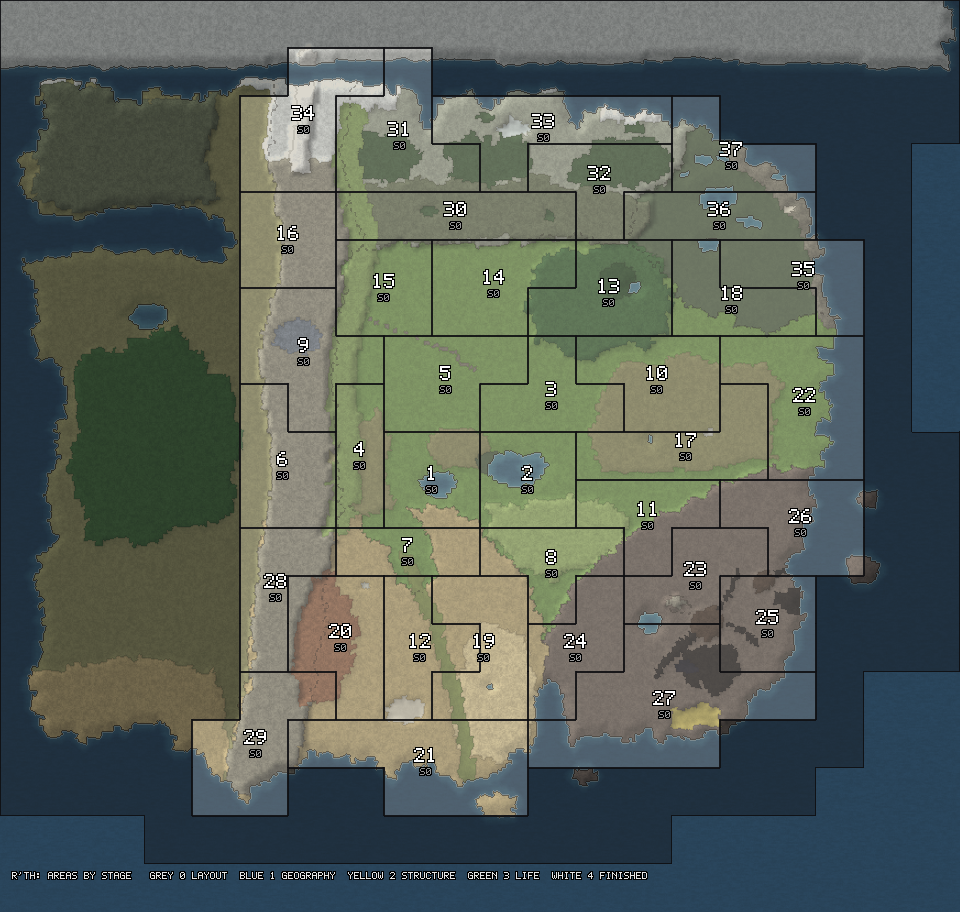

# Building the world in areas

Status: **started** (2026-10-25). Every area is at stage 0: the generated layout
([world-plan.md](world-plan.md)). This is how the world gets from there to finished, one area and
one stage at a time, with a list to tick.



## Why areas

The world is 330 regions. Working on all of them at once spreads every pass thin, which is how the
first world ended up feeling like nowhere. Working on one region at a time loses the shape: a lake,
a city and its approaches, a valley all cross region borders. So the unit is the **area**: 3 to 8
regions with one identity (*Knellmere and the lake road*, *Meridian*, *the badlands and Adit*), small
enough to finish, big enough to mean something ([world-guide.md](world-guide.md) section 2).

- **37 areas** cover the continent's 180 regions with core land. Every region is in exactly one
  (`WorldAreasTests` checks it).
- **The frontiers and the open sea** (158 regions) are one area held back: drawn, never built, until
  a frontier opens.
- An area is a set of region scenes, nothing more: in Unity, open one of its regions and use
  **R'th > Open Selected Area** (Alt+Shift+O, or right-click its scene in the Hierarchy) to open the rest beside it.

## The standard

Four stages ([world-guide.md](world-guide.md) section 5), each a few work packages. An area reaches a
stage when every package of it, and of every stage before it, is ticked. The full text of each
package's "done when" is in `world/areas.json`.

| Stage | Goal | Packages |
| --- | --- | --- |
| **1. Geography** | The land is right: its shape, water and ground read as the brief says, walked at player height. | 1.1 Brief · 1.2 Taken over · 1.3 Landforms · 1.4 Water · 1.5 Ground · 1.6 Walked |
| **2. Structure** | The layout is right: roads, settlements, landmarks and edges are where they will stay. | 2.1 Routes · 2.2 Settlements · 2.3 Landmarks · 2.4 Edges · 2.5 Sites · 2.6 Walked |
| **3. Life** | It is a place to play: resources, creatures, people and hooks, counted against the brief. | 3.1 Resources · 3.2 Creatures · 3.3 People and services · 3.4 Hooks · 3.5 Checked · 3.6 Played |
| **4. Finish** | It looks finished. | 4.1 Assets · 4.2 Dressing · 4.3 Atmosphere · 4.4 Final walk |

The packages that end in **Walked** or **Played** are the owner's: a stage is signed off by walking
it, not by looking at it from above.

## The order

The areas come in waves, nearest the start first. The rule:

1. **Wave 1 goes to stage 2 first**: *Tolling and Wennow*, *Knellmere and the lake road*, *Cruor and
   the meander* and *the western march*. It is where every player's first hours happen, and taking it
   all the way through structure proves the standard, the tools and the briefs before they are used
   37 times.
2. **Then stage 1 everywhere, wave by wave** (2, 3, 4, 5). Geography is cheap and decides most of
   what comes after; the whole continent should have its land right before much is built on it.
3. **Then stage 2 wave by wave**, then stage 3 with the area plan's passes (A4: resources,
   infrastructure, activities and quests are spread over many areas at once, so stage 3 follows the
   plan, not one area), then stage 4 with the art.
4. Within a wave, any order; one area per branch at a time ([world-guide.md](world-guide.md) section 8).

| Wave | Areas |
| --- | --- |
| 1 | Tolling and Wennow · Knellmere and the lake road · Cruor and the meander · The western march |
| 2 | The great bridge and the dry valley · The salt pass and the high valley · Sere's river: the salient and the sluice · The Downs · Selenfall's breach · The east road |
| 3 | The front below the Scarp · Cistern and the gravel plain · Eller · The north farms and the moor's edge · The foothills salient · Meridian · The Wolds · Brack's edge and the causeway |
| 4 | The ribbon and the erg · The badlands and Adit · Sere's coast and the delta · The east coast and the enclave · Kiln and the great cone · The gall-front and the fissures · Ember and Cinderport · Gall's east coast · The obsidian and sulphur coast |
| 5 | The dwarves' pass · The red teeth · The moors · The pinewoods and the trapper · The eastern moors · The frozen lake and the fjords · The frozen spine and Frostpeak · Skerrin and the broken coast · The meres · Umber's meres |

## Ticking a package

Add its id to the area's `done` in `world/areas.json`, with the date and, if useful, a word:

```json
{ "id": "lake-road", ..., "done": { "1.1": "2026-10-26", "1.2": "2026-10-26 regions taken over" } }
```

Then `dotnet run --project tools/world -- areas` checks the file, prints every area's stage and next
package, and redraws the coverage map (`docs/images/areas.png`); `areas check` only checks. Moving a
region to another area is an edit to the same file.

## The brief (package 1.1)

One page, `docs/areas/<area id>.md`, before any work on the ground ([world-example.md](world-example.md)
is a worked one). It takes its facts from [world-plan.md](world-plan.md) and the layout, and answers:

| Heading | What it says |
| --- | --- |
| **For** | What the area is for in the game and when players come (early, mid, late). |
| **Who** | Who lives here, and which powers' stories pass through. |
| **Shape** | The one shape you remember; its landforms, water and ground (four or five colours). |
| **Vision and levels** | What the area is for and why players come at each stage (things to do, points of interest, what is below ground, its futures in a year, five, ten), then its vertical plan from that ([world-scale.md](world-scale.md) section 3): each height's job and routes; busy ground stays level, height in towns is built and below. Example: [areas/heartland-vision.md](areas/heartland-vision.md). |
| **Landmarks and views** | One or two landmarks and where each is seen from; the views to keep clear. |
| **Routes** | Every road, path and river in and out, and where each meets its neighbour area. |
| **Places** | Its settlements and sites, each with a line on what it will hold. |
| **Counts** | Resources and creatures by kind, count and tier (stage 3 is checked against these). |
| **Checklist** | [world-guide.md](world-guide.md) section 6, ticked or answered. |

Taking regions over (1.2) freezes their generated base, so the layout and the generator can still
change everywhere else without moving a finished hill.
