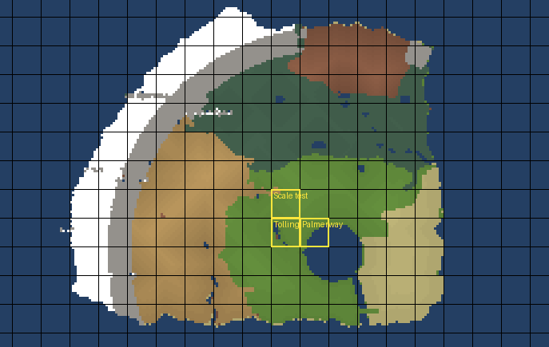

# Building a coherent world

> **Partly superseded** (2026-10-23): drawn on the old map (the bay, the Cradle, Calcinia). The
> continent's layout is now `world/layout/continent.json` (`docs/layout.md`), which answers W1 and
> W2; the canon is `docs/lore.md`.

Status: **proposed, with a working prototype of the layout step** (2026-10-22). How the world
sketched in `images/map.png` becomes one piece of geography instead of separate scenes. Sizes and
terrain rules are in [world-scale.md](world-scale.md); art rules in [assets.md](assets.md).

## 1. The problem

Today each region is its own Unity scene, built by its own builder on a flat box of ground.
Regions meet because their builders agree by hand (Palmerway redraws Tolling's circle of Wennow
so the water lines up). Nothing says how high the land is, where rivers run or what the ground
should look like between places, so each new region is invented from scratch and the world
reads as a row of sets.

## 2. Three layers

| Layer | What it holds | Where | Who edits it |
| --- | --- | --- | --- |
| **1. The layout** | For every 8 × 8 zone: a biome and a macro height. Later: rivers and roads as lines. | `client/Assets/World/layout.json` | Painted once from the sketch, then edited by hand |
| **2. The bake** | Each region's ground: layout height + the biome's base noise + the region's stamps, the biome's colours, the impassable tiles | the region's `MapTerrain` (generated) | Nobody: **R'th > World > Bake Terrain From Layout** |
| **3. The detail** | Everything placed (houses, trees, stations, spawns) and **stamps** (flatten a town, raise a hill, dig a pond) | the region's scene | People, in the Editor or in a builder |

The rule that keeps detail: **never sculpt the baked heights by hand.** Change the ground with a
`MapTerrainStamp`, which belongs to the scene and is re-applied on every bake. Placed things ride
the ground: a re-bake moves each piece up or down by however much the ground under it changed.
So the layout can change (a hill moved, the coast redrawn) and the town on it stays a town.

Every region samples the **same functions of absolute position** (the layout's height is smooth
between zone centres; the base noise has one seed for the world), so neighbouring regions meet
exactly at their borders without knowing about each other.

## 3. The world layout

`layout.json` is a text grid, one character per zone, rows from north to south, so it diffs well
and can be edited in any editor:

- **`zones`**: a biome letter per zone. `~` sea and lakes, `v` Venaria, `s` Sere, `f` Slough's
  fens, `x` Scalth, `c` Calcinia, `m` Candora (the mountain wall), `n` Nivil (the frozen north).
- **`heights`**: a digit per zone, `0`–`9` then `a`–`z`, in half tiles (0 to 17.5), matching the
  reference's 16-tile world.
- **`biomes`**: per letter, the ground colour (a palette name), whether it is water, whether it
  is walked on, and its base noise amplitude.
- **One sea level** (`seaLevel`, 0): every water zone sits at it, and a tile corner touching
  water does too, so coasts meet the sea.

**The prototype** (`tools/world-layout/layout_from_sketch.py`) made the first layout from the
sketch: it reads the sketch's colours zone by zone, ignores label text, and raises land with its
distance from water (mountains and snow stand high). The result, with 96-tile regions gridded
and today's regions outlined:

At 64 tiles per sketch square, the land is **113 regions of 96 × 96** (Venaria 3 500 zones,
Sere 3 200, Slough 3 100, Nivil 2 100, Candora 1 700, Calcinia 1 600, Scalth 1 200), about the
size of the 2004 game's surface (1.1 million tiles).

**Decision W1: the world's size** (tiles per sketch square). 64 gives a world the size of the
reference, about 113 regions. 96 would make every square one region and the world about
twice as large; most of it would be empty road. **Proposal: 64.**

**Decision W2: where Tolling sits.** The sketch puts Tolling a square west of the bay; at 64
tiles a square the bay then covers the east half of Palmerway, where today's regions have
Wennow (a mere) and the waygate. `world-map.md` says Tolling is "many days upstream of Cruor".
Either Tolling moves west on the layout (change `TOLLING_PX` in the script and re-run, or paint
the layout), or the bay shrinks. **Proposal: move Tolling two or three squares west, up the
river to where Venaria's green gives way to Sere's brown, which is where the lore puts it and
leaves room for Palmerway and the road to Cruor.** Nothing is baked into Tolling or Palmerway until this is decided.

**Rivers and roads.** The sketch's rivers are too thin to survive at 8 tiles a zone, so they are
not in the layout yet. Proposed: `rivers` and `roads` as lists of polylines in absolute tiles.
A river carves a channel (a stamp along a line, water tiles under it) whose level only steps down
at falls, and every river ends in the Cradle; the bake checks that the macro height never rises
along a river's course. A road flattens a strip slightly and paints the road overlay. Estimate:
**2 days** with tests.

## 4. Blocking out and detailing a region

1. **Make the scene** with a builder (`WorldKit.BeginRegion(..., ground: null)`) or by hand:
   a `MapArea` at the region's rectangle.
2. **Bake**: R'th > World > Bake Terrain From Layout. The region gets a `MapTerrain` with the
   layout's heights and colours; water, mountain and snow tiles are marked impassable.
3. **Shape it** with stamps: `Level` under a town or a field, `Add` for a hill or a barrow,
   `Set` for a dug pond or a quarry floor. Re-bake to see them.
4. **Place things** on the ground (`GroundHeight` / `field.Sample` in builders; the Editor's
   snapping by hand). The exporter, streaming and the server work as before.
5. When the layout changes, **re-bake**: the ground moves, stamps re-apply, placed things ride.

`ScaleTestBuilder` is the worked example of a terrain region; it shapes its ground in code
rather than from the layout, because it tests exact heights.

**Existing regions.** Tolling and Palmerway stay flat until W2 is decided and the sizes in
`world-scale.md` are settled. Then: Level stamps under the towns, fields and roads, a bake, and
a walk round. The bake warns before it switches off a region's flat ground.

## 5. How it fits the pipeline

- **Scenes stay the unit**: one region, one scene, one `MapArea`. The layout adds data above
  them, not a new kind of scene.
- **The exporter is the only path to the server**, as before. It now also blocks `MapTerrain`
  tiles that are too steep (cliffs) or marked impassable (water, the mountain wall).
- **The server has no heights** and needs none: movement and line of sight stay on the tile grid.
- **The client stands things on the ground** (`GroundHeight`), and the camera lifts over it.
- **R'th > World > Open Whole World** opens every region side by side; baking with several open
  bakes each, and they meet at their borders.

## 6. The ground layer

The 2004 ground is two layers: a **plain colour blended over about 11 tiles** (grass shading
into mud with no edge) and **crisp overlays** (paths, floors, shores) with **12 shapes × 4
rotations** so that they run diagonally without stair-steps.

- **Blended colours: built.** `MapTerrain` keeps a colour per tile and blends it over `blend`
  tiles (a box blur both ways, drawn through a bilinear texture). The layout gives the biome's
  colour; stamps or builders can paint tiles. Cliffs stay crisp in the cliff colour.
- **Shaped overlays: proposed.** A second per-tile layer: an overlay colour (a palette name), a
  shape (full, half, three corner cuts, diagonal, and so on: 12) and a rotation. `MapTerrain`
  draws it as a second, unblended mesh just above the ground, each tile cut along its shape, so
  a road runs diagonally as a straight edge and a shore follows the water. Roads, floors and
  shores would paint overlays instead of placing thin boxes. Estimate: **2–3 days** (the shape
  table, the mesh, painting from road and river lines, tests for the shapes).

## 7. Follow-up work

| Work | Estimate |
| --- | --- |
| Rivers and roads in the layout, carved and painted by the bake (section 3) | 2 days |
| Shaped overlays on `MapTerrain` (section 6) | 2–3 days |
| A layout painter: an Editor window over the zone grid to paint biomes and heights | 2 days |
| The world map modal drawn from the layout instead of region rectangles | 1 day |
| A scale check in the art validator: cliff share and relief per 24 × 24 window per region | 0.5 day |
| Moving Tolling and Palmerway onto terrain (after W2, D1–D4) | 1–2 days, mostly checking by eye |
