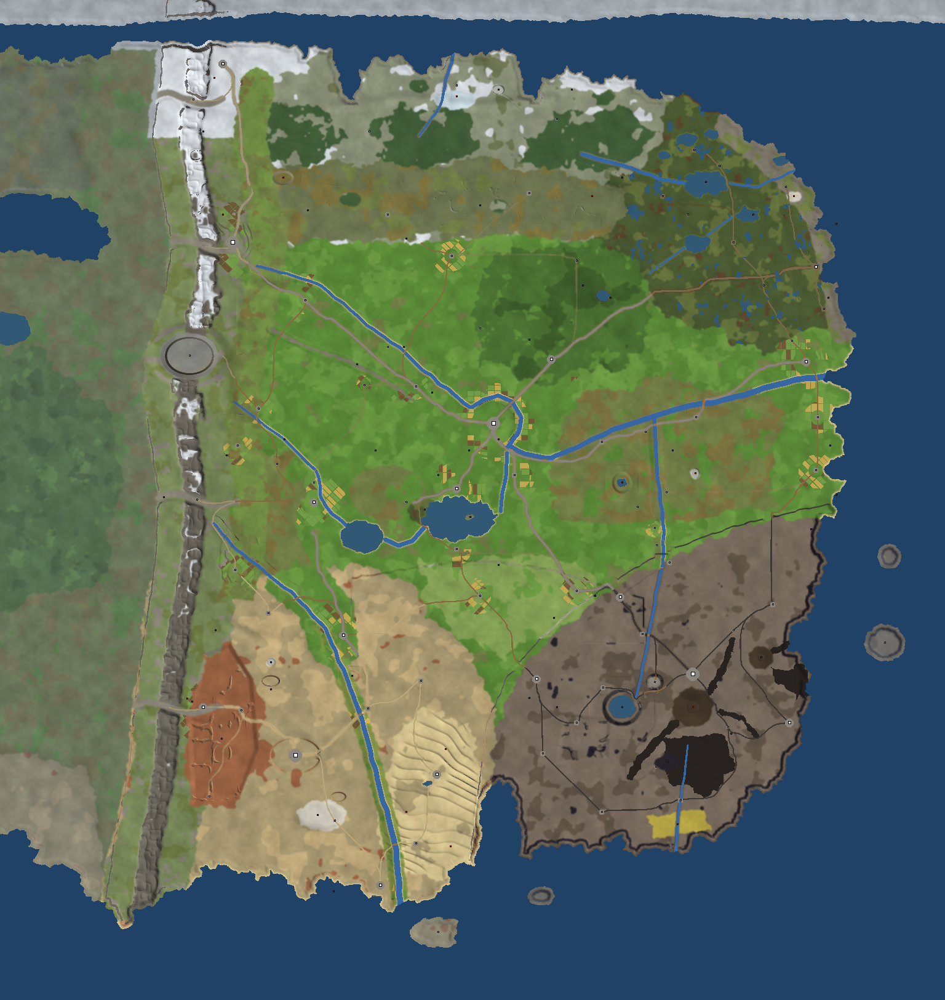

# The world plan: R'th rethought

> **The GDD is the truth** (2026-11-03): this subject is now written in docs/gdd/3-story/world.md, realms/ and areas.md. Where they disagree, the GDD wins; this doc is raw material, to be cut down once the GDD page is approved.

Status: **built in data, waiting on the owner's walk** (2026-10-25), on `claude/world-remake`. It
replaces the first layout's geography (`layout.md` keeps the data format). The layout
(`world/layout/continent.json`), the generator (`Landscape`) and the ground painting
(`shared/World/Ground`) follow it, and every area brief starts from it. Coordinates are absolute
tiles (Tolling's south-west corner is (0, 0), east +x, north +y). `p-` names never reach players.



| Picture | What it shows |
| --- | --- |
| [world-paint-world.png](images/world-paint-world.png) | The whole continent, one pixel a tile, painted and lit as the client draws it. |
| [world-area-heart.png](images/world-area-heart.png) | The heartland: Knellmere, Cruor in its meander, the Downs, the Scarp's foot. Two pixels a tile. |
| [world-area-sere.png](images/world-area-sere.png) | Sere: the river's green ribbon, the badlands, Cistern's mesa, the salt pan, the erg. |
| [world-area-gall.png](images/world-area-gall.png) | Gall's plateau: the caldera lake, the great cone and Kiln, lava tongues, the cinder roads. |
| [world-area-brack.png](images/world-area-brack.png) | Brack: fens, meres, channels and the broken coast. |
| [world-area-north.png](images/world-area-north.png) | The cold north: moors, pinewoods, the frozen lake, fjords. |
| [world-close-lake.png](images/world-close-lake.png), [world-close-cruor.png](images/world-close-cruor.png) | Five pixels a tile: the ground at the player's scale (lakeport and Knellmere; Cruor's river loop and bridges). |

---

## 1. Why the first world didn't work

Walking the first blockout, the world felt like nowhere. The reasons, most important first:

1. **Ground was decided by who owns it.** Each power had one ground (the empire farmland, Gall ash,
   Sere scrub) with a few ellipses painted on. Real land is the other way round: the shape of the
   land decides where people live and where borders fall. Owning a region doesn't make it look
   like anything.
2. **No landforms.** Apart from the spine everything was flat. There were no hills to climb, no
   valleys to follow, no edges to look over, so there was nothing to see from anywhere and
   nothing to steer by.
3. **Lines instead of geography.** Rivers were straight segments pasted on top; roads were
   straight lines between dots; lakes were ellipses; places were squares. Nothing followed
   anything else, so nothing explained anything else.
4. **Ground painted like a spreadsheet.** One flat colour a tile, with hard pixel borders between
   kinds; paths were stair-stepped boxes of a single colour; rivers were stair-stepped boxes of
   blue. Rectangles of heath sat on a green field. RuneScape's ground never looks like that.
5. **Distance without beats.** Long stretches of identical land with nothing on them: 300 tiles
   of farmland is three minutes of nothing.

## 2. What makes a world interesting (the rules this plan follows)

These come from how RuneScape's world is built, from Albion's and Blizzard's zone work
(`world-guide.md` section 11) and from the lore. Every area brief checks itself against them.

1. **Land first, then people.** Lay down the landforms (ranges, scarps, valleys, plateaus,
   basins, coasts), let water run off them, then put people where people would live: at
   crossings, springs, harbours, defensible rocks, the mouths of passes, the edges of resources.
   A player should be able to guess why a town is where it is.
2. **Borders follow the land.** Power borders and biome changes run along rivers, ridges,
   escarpments and coasts. Crossing from one power to another is then a *moment*: a bridge, a
   ramp up a cliff, a pass, a causeway, a gate, never a colour change in open grass.
3. **One shape you remember per area.** Each area has a big, simple form you can describe in a
   sentence and see from inside it: the lake, the meander round Cruor's hill, the Scarp, the
   crater, the tors on the moor, the sea stacks. Clarity beats clutter.
4. **Pockets for content.** Inside the big shapes, small enclosed places to fill later: coves,
   clearings, hollows, ledges, islands, side valleys, a ruin in a fold of the hills. A pocket is
   where a quest, a boss or a skilling spot goes. The plan reserves them as **sites** (section 6).
5. **The world is read from its roads.** Most players see the land from the road, so roads are
   designed as journeys: they follow valleys and contours, bend round hills, cross rivers at
   bridges that are places, and reveal things (top a rise and the lake opens out with Cruor's
   hill beyond). On a main road there is **a beat every 60-100 tiles** (30-50 seconds running):
   a settlement, a landmark, a junction, a bridge, a view. Quiet stretches between beats are good
   for contrast; 200 tiles of nothing is not.
6. **Each power builds its own roads.** The road tells you whose land you are in:
   - the empire's roads out in the land are gravel paths and dirt tracks that wander in easy
     bends (paving is for towns, not the wild);
   - Sere's are caravan tracks from well to well, marked by cairns;
   - the spine's are switchbacks with a toll gate at every crossing ("every crossing pays");
   - Gall's are black cinder roads between lava fields;
   - Brack's are causeways and plank walks over the fens;
   - the cold north has trodden paths and nothing else.
7. **Landmarks to steer by.** The spine is always west, the sea east, the cold north up. On top of
   that each area has a skyline landmark seen from far off (section 4). Players should be able to
   find their way back without the map.
8. **Danger reads before it bites.** The heartland round Cruor is green, settled and safe. Each
   periphery has an easy fringe and a harsh core, and the land gets emptier, darker and stranger
   on the way in.
9. **Natural gates.** The world opens up as players progress, and the land provides the gates:
   the waygate on Palmerway (built), the toll passes, the ramps up the Scarp (at war), the sluice
   at the riverhold, the fen causeways, Selenfall's gate, the long road north. A gate is a place,
   and later a quest or a requirement.
10. **The lore is in the ground.** R'th is an unfinished world being revised. The land shows it:
    **unfinished places** (unnaturally regular ground, never quite completed), a **dry valley**
    whose river was moved, a road that ends at nothing (a town taken out), old **moonfall
    craters**, Selenfall's breach, and the frontiers where the world is still being made.
11. **Real verticality, planned** (owner, 2026-11-02; `world-scale.md` section 3). Height is
    spent boldly where it tells the story and shapes the routes: the spine's walls and passes, the
    Scarp, the volcanoes, the mesas, Cruor's hill, the moor's tors, gorges, crags and terraces. Every
    area plans its levels and the ways between them; flat land is flat on purpose.
12. **Room to grow.** Frontiers on three sides, reserved sites in every area, and a layout that
    adds places without moving old ones.

## 3. The continent

### The big structure

```
                     the far north (frontier)
        ~~~~~~~~ fjords ~~~~~~~ the cold north (Nivil) ~~~~~~~~~~~~~
   F    |Frostpeak                  tundra, pines, moors, tors        \ broken coast
   R    |  the frozen spine                                    Brack:  \  sea stacks
   O    |    Meridian ......... the great river's source        fens,   |  (Skerrin)
   N    |  the spine          Eller (forest)      the Wolds     meres   |
   T  west   Selenfall    ......great river.....CRUOR............. enclave
   I  face |   foothills          Knellmere (lake)              ~ east coast
   E    |  salt pass  TOLLING~Wennow~Palmerway    the Downs          |
   R    |      high valley       the Scarp ////////////////////////  |
        |  Sere's river (empire salient, the sluice)   GALL: plateau,  |
        | badlands, Adit     Cistern (wells)            volcanoes, Kiln
        |      Sere: gravel, the salt pan, the erg  |   lava, ash   Cinderport
         ~~~~~ Sere's coast, the delta ~~~ gulf ~~~~~~~ Gall's black coast ~~~
                         islands (frontier, by ship)
```

The spine runs the whole height of the west. Everything east of it drains east and south. Three
great lines divide the eastern land: **the great river** (west to east across the north of the
empire, to the sea at the enclave), **the Scarp** (the escarpment that lifts Gall's volcanic
plateau above the empire, south-west to north-east) and **the edge of the rain shadow** (where the
green west of the empire dries into Sere, just south of Tolling).

### Height

| Land | Height (tiles) |
| --- | --- |
| Sea, lakes, the fens | 0-0.5 |
| The empire's lowland, river valleys | 0-2, rolling |
| Downs, the Wolds, Eller's hills, Cruor's hill | 2-5 |
| Gall's plateau, Sere's gravel plain, the moors | 4-7 |
| The spine's foothills, the high valleys, mesas | 4-8 |
| The spine's crest, the volcano's cone | 9-14, peaks to 16 |

Tolling sits in the low Wennow basin (0-1.5), the town itself on a low knoll above the water
meadows, and the land rises west to the foothills and south to Sere's plain.

### Areas

Each area: the shape you remember, what the land is like, and where its pockets are.

#### Venaria, the empire's heartland (Cruor's empire)

- **Tolling and Wennow**. A low river basin where the green begins to dry. Tolling's
  river comes down from the foothills in the north-west, through Tolling, into the broad mere of
  Wennow, and on east.
- **Palmerway** and **the lake road.** Heath east of Tolling, the waygate, then the road
  runs east along the river's valley, past fields round the first villages, over a low rise where
  the whole of **Knellmere** (p-lake) opens out: a great lake with islands, reed fens on its west
  shore, a drowned belfry off its south shore. **p-lakeport** on the north shore.
- **Cruor and the meander.** The great river comes from the north-west and the lake's outflow from
  the south-west; they meet below **Cruor's hill**, and the great river loops round the hill on
  three sides before running east. The city stands on the hill, the cathedral at its crown, seen
  from everywhere in the heartland. Wide open ground round it: fields, the monument road, gardens.
- **Eller** (p-forest), north of the great river: low wooded hills, a forest town at its edge,
  an old-growth heart with a woodland lake, clearings (pockets) and the forest road through it.
- **The Downs**, south of the lake: rolling chalk hills with a steep north-facing edge, a hill
  figure cut in the chalk (a landmark seen from the lake), long views south to the Scarp.
- **The Wolds**, east of Cruor: high rolling farmland and sheep country, broken by the great
  river's valley, down to **the east coast**: cliffs and coves, a fishing village in each of two
  coves.
- **The western march**: dry downs and scrub between Tolling and the foothills, the salt road to
  the pass, the dry farms at the foot of Selenfall's road.
- **The foothills salient**: the empire's spur of forts and farms climbing the spine's foothills
  below Meridian (p-foothold), where the great river comes out of the mountains.
- **Skyline:** Cruor's hill and spire; the hill figure; the spine always to the west.

#### The Scarp and the front (empire against Gall)

**The Scarp** is the second spine of the world: an escarpment about 3 tiles high that lifts Gall's
plateau above the empire's lowland, running some 700 tiles from the southern gulf to the east
coast. Its face is cliff, climbable only at a handful of **ramps**, and those ramps are the front:
"open war along a long front; neither can win". Gall can't come down in force; the empire can't
get up.

| Crossing | What it is |
| --- | --- |
| The west ramp | Gall's border town **p-gall-front** on the edge above; the empire's downs village below. |
| **The Frontline** | The great ramp the main road climbs. **p-frontline**, a border town at its head that changes hands. |
| **The falls** | **p-head**: an enormous face carved in the Scarp, the river from Gall's plateau pouring from its mouth into a pool, and on its brow the village **p-brow**. Neutral ground: both sides leave the face alone. |
| The coast ramp | Where the coast road climbs near the sea, guarded by both sides. |

Below the Scarp: the empire's camps, burned farms, a no-man's strip. Above it: Gall's watchtowers.

#### House Gall's plateau (House Gall)

A raised volcanic table (4-7 tiles) above the Scarp, with three volcanoes:
- **p-cinder-mount**, the great cone (to about 14), with **Kiln** (p-gall-seat), Gall's city,
  terraced on its northern flank, its fires seen from far down in the empire at night;
- **p-ember-mount**, still active, near the east coast, whose lava runs into the sea and makes new
  land (the world growing, in front of you); **p-cinderport** on the black coast beside it;
- **p-slag-mount**, old and collapsed, its caldera a lake: the source of the river that crosses
  the plateau and falls from p-head's mouth.

Between them: grey ash plains, **lava fields** (rough black rock nobody walks, crossed by the cinder
roads), obsidian flats, hot springs, yellow sulphur flats on the south coast. **The fortress
pocket**: a sheer volcanic plug between the caldera and Kiln, held by the empire, impossible to
take and impossible to leave. **Skyline:** the cone and its plume.

#### Sere, the rain shadow

The spine takes the rain; Sere gets what runs off it.
- **Sere's river** rises in the spine's high valleys west of Tolling, comes out of the foothills
  south-west of Tolling and runs south through all of Sere to the sea. Its valley is a green ribbon
  of farms in the desert. **The empire holds its upper course** (the salient) and its gorge, where
  **p-riverhold** keeps a sluice that could close the river: the hand on Sere's water. Sere pays.
- **Cistern** stands on a mesa in the gravel plain, **away from the river**, on wells sunk deeper
  than anyone else can dig: whatever the empire does to the river, Cistern drinks.
- **The badlands**: red mesas and canyons under the spine, the dwarves' southern hold **Adit**
  (p-dwarf-hold) at the mouth of a great cave in the spine's foot, the caravanserai on the road to
  it. Canyons are pockets.
- **The salt pan**: a dry white lake bed, perfectly flat, with mirages (a place with no history).
- **The erg**: dunes in the south-east, **p-oasis** in a hollow among them.
- **The delta and the coast**: the river's mouth, Sere's port, low cliffs, the ferry to the islands.
- **Skyline:** Cistern's mesa; the spine's red southern teeth.

#### The spine (the surface people above, the dwarves below)

A range the height of the continent, broad and gentle on the east, a **sheer face on the west**
falling to the frontier. Along its length:
- **The red teeth** in the south: lower, dry, the dwarves' pass beside Adit.
- **The high valleys** west of Tolling: alpine pasture, terraced farms, the surface people's
  observatories, Sere's river's source, **the salt pass** (the nearest crossing to Tolling, a toll
  gate at its top).
- **Selenfall's breach** (built, stage 1): the crater that tore through the crest.
- **Meridian**, the surface people's capital, on a terraced shoulder of the eastern slopes above
  the great river's source, under the highest peaks; **the Meridian pass** behind it.
- **The frozen spine**: glaciers coming down to the north coast, the frost pass, and **Frostpeak
  Forge** at the range's very end, a hall cut into the last peak above the northern sea.
- From every pass the frontier is in view to the west: land where the world grows next.
- **Skyline:** the whole range; Selenfall's notch; Meridian's domes.

#### Brack, the lesser houses' fens

Low, wet, flat and broken: a maze of meres, channels and reed beds, with dry **holms** (islands of
higher ground) holding the houses' holds, and causeways between them. The fens end at the sea in
**the broken coast**: cliffs, sea caves, stacks and skerries.
- **Skerrin** (p-houses), where the houses meet, built among the sea stacks.
- **House Mordant's sea caves**; **Scalth**, the scalding pans on the coast where the mites breed;
  **House Umber's hold** on a holm in the northern meres, near the cold; **Sallow's fallen house**,
  a ruin on a drowned holm.
- **The enclave**: the empire's walled port at the great river's mouth, on the edge of the fens,
  with the causeway (Causeholm) its soldiers use to reach into them.
- **Skyline:** the sea stacks; the enclave's walls across the flat.

#### The cold north (Nivil, unclaimed)

North of Eller the land climbs onto **the moors**: high, open, lumpy ground with granite **tors**,
bogs and standing stones, then a belt of **pines**, then **tundra** and snowfields down to a north
coast of **fjords**. Glacier tongues come down from the frozen spine. Trappers' camps, a frozen
lake, frontier peoples. **Skyline:** the tors; the white wall of the frozen spine.

#### Frontiers (not in the first build)

West of the spine, the far north beyond the fjords, and the southern and eastern islands. Drawn as
land, not walked yet: seen from the passes, the coasts and the ships.

## 4. Where places go

The rule: **every settlement is sited for a reason a player can see.** Tiers as in
`world-guide.md` section 2. Capitals are where travel is measured from.

### Cities

| City | Site | Why there |
| --- | --- | --- |
| **Cruor** | A hill in the great river's meander, at the lake outflow's confluence | Defended on three sides by water, at the meeting of the roads and rivers; the cathedral on the crown. The biggest place in the world, built with open ground, not density. |
| **Meridian** | A terraced shoulder of the spine's eastern slopes, under the highest peaks | Above the great river's source and the Meridian pass: whoever holds it holds the crossing. Dry clear air for the observatories. |
| **Cistern** | A mesa in Sere's gravel plain, away from the river | The deepest wells; out of reach of the empire's sluice. |
| **Kiln** (p-gall-seat) | Terraces on the great cone's north flank | Fire is Gall's power; the city lives on the volcano. |

### Towns

| Town | Site | Role |
| --- | --- | --- |
| Tolling | The Wennow basin, on a knoll | The start. |
| p-lakeport | Knellmere's north shore, where the lake road meets the water | Boats on the lake, fishing, the first big market on the road to Cruor. |
| p-forestgate | Eller's south edge, where the forest road enters the trees | Woodcutting and hunting; the way into the forest. |
| p-riverhold | The gorge on Sere's river | The sluice fortress; the empire's salient. |
| p-frontline | The head of the great ramp on the Scarp | A border town that changes hands. |
| p-enclave | The great river's mouth | The empire's walled port in the fens. |
| Frostpeak Forge | The spine's last peak, above the northern sea | The dwarves' trading hall. |
| Adit (p-dwarf-hold) | A great cave in the spine's foot, in the badlands | Where the dwarves' caves open; the southern pass. |
| Skerrin (p-houses) | Sea stacks on the broken coast | Where the lesser houses meet. |
| p-gall-front | The edge of Gall's plateau above the west ramp | Gall's border town. |
| p-cinderport | The black coast beside the active volcano | Gall's port. |
| p-oasis | A hollow in the erg with a spring | Sere's second town, the caravans' rest. |
| p-sere-port | Sere's river delta | Sere's port, and the ferry south. |

### In the mountains

The spine is a `range` landform (`continent.json` relief `the-spine`): a massif about 150 tiles
across, a crest of 11-14 tiles with snow on its high peaks (more of it the further north), spurs
running out east every 30 tiles or so with valleys between them, a high shelf on the west above
the sheer face, and five passes cut down to saddles. Its people live in the valleys, on the
shoulders and at the passes:

| Place | Where in the range | What it is |
| --- | --- | --- |
| **Meridian** (city) | A terraced shoulder on the eastern slopes, under the highest snow peaks, 40 tiles east of the Meridian pass's saddle; the great river rises in a tarn just below it | The surface people's capital: whoever holds it holds that crossing. |
| **Frostpeak Forge** (town) | The range's north end, above the northern sea, under the frost pass | The dwarves' trading hall, cut into the last peak. |
| **Adit** (p-dwarf-hold, town) | The range's eastern foot in the south, at the mouth of the dwarves' pass | Where the dwarves' caves open, facing Sere's badlands. |
| p-high-valley (village) | A terraced high valley west of Tolling, below the tarn where Sere's river rises | Alpine farms; the way up to the salt pass. |
| p-observatory (village) | The top of a spur above the western march | An observatory of the surface people. |
| p-west-toll, p-frost-toll (hamlets) | On the saddles of the salt pass and the frost pass | The tolls: every crossing pays. |
| p-south-observatory (hamlet) | High on the dry southern teeth | An observatory. |
| Selenfall (landmark) | The crater that breaks the crest north-west of Tolling | Built by hand (L4). |

Spur valleys between them are left for content: the sites `s-high-cave`, `s-observatory-vault`,
`s-orrery-peak`, `s-glacier-boss`, `s-undermost` and the seals.

### Villages and hamlets

Sited the same way: at bridges and fords (p-greatbridge, p-ford), weirs and mills (p-weir), coves
(two fishing villages on the east coast), springs and wells (Sere's well villages), the foot and
top of passes (toll hamlets), holms in the fens, edges of the moor. Farmland is drawn **round
villages**, as fields, not as the colour of a whole power: between villages lies pasture, heath,
copses and common land. The full list, with each place's reason, is in `continent.json` (`places`,
each with a `note`) and drawn on `docs/images/layout-continent.png`.

### The ladder

The layout keeps to `targets.json`'s ladder (towns 0.5-1.5, villages 1.5-4 per 100k tiles of core
land) and counts it in `tools/world layout`: 4 cities, 13 towns, 34 villages and 22 hamlets on 1.37M
tiles of core land (0.95 towns and 2.48 villages per 100k).

## 5. The rhythm of the main roads

The first journeys, checked against rule 5 (a beat every 60-100 tiles):

| Road | Beats |
| --- | --- |
| Tolling to Cruor (the lake road) | Tolling, Wennow, Palmerway's monument, the waygate, the river villages' fields, the rise with the lake view, p-lakeport, the lake's outflow and p-weir, the meander bridge, Cruor's gate. |
| Tolling to the salt pass | The western march, the dry farms, the foothills, the high valley's terraces, the toll gate at the top, the view west over the frontier. |
| Cruor to Meridian (the north road) | The meander, p-greatbridge over the great river, the foothills salient, the river's gorge, Meridian's terraces. |
| Cruor to the front | The Downs, the hill figure, the burned farms, the camps below the Scarp, the Frontline ramp. |
| Tolling to Cistern (the Sere road) | The edge of the green, the salient's fields, the riverhold's sluice, the ribbon of farms, the gravel plain, the mesa. |

## 6. Sites: reserved for what comes later

A **site** is a spot kept free for content that isn't designed yet: a dungeon mouth, a boss lair, a
ruin, a skilling ground, a quest location. Each is a point with a kind, a stage and a note in
`continent.json` (`sites`), kept off the players' map, and marked in the blockout by a 2 × 2 patch
of dark marker paving so it can be found while walking. They are placed in pockets (rule 4): 63 of
them, every area with a few at each stage. Kinds:

| Kind | What it is for |
| --- | --- |
| `dungeon`, `cave` | An entrance to an underground region (1024 tiles north, `world-guide.md` 3). |
| `ruin` | Old stones: a quest, a reading, a small fight. Some in a style nobody made (the revisions). |
| `unfinished` | A place the world never finished: unnaturally regular ground, a quest for scholars. |
| `moved` | Something that is not where the old maps put it (the dry valley, a road to nothing). |
| `moonfall` | An old fall's crater; later a fresh fall can land near one. |
| `demigod` | One of p-scattered's pieces (the herbs-of-signature places). |
| `cell` | A hidden occult cell inside the empire. |
| `monument` | Room for one of the church's blood monuments along the empire's roads. |
| `seal` | One of the deep's seals, kept by the dwarves. |
| `thin` | A place where the Dreaming is close (sleepwalkers, the nightmare). |
| `story` | A place in a quest's story, kept free for it (where the player was found). |
| `spoil` | Where something leaks back from p-spoil. |
| `boss` | An open-world boss arena. |
| `lookout` | A view worth a climb (a reading, a clue, a teleport). |
| `skilling` | A gathering ground worth a trip (a rich seam, an old wood, a fishing spot). |

## 7. How the ground is painted

The ground carries most of the world's colour (`research/04-osrs-assets.md`), so it is painted the
way RuneScape paints it: **two layers**.

**Underlay: the land itself, blended.** Grass, meadow, heath, moor, sand, mud, scree, snow. Each
tile has an underlay, and the colour drawn at any point is a weighted blend over the tiles around
it (a radius of about 2 tiles), weighted by how alike the colours are: close colours (grass and
meadow) shade into each other over a few tiles and no tile edge ever shows, while very different
ones (pasture and scree) meet at an edge half a tile wide instead of smearing into a stain. Variety comes from **low-frequency patches** of two or three related
underlays (meadow in the grass, bracken in the heath), never from per-tile speckle. Height and
slope shade it: slopes facing the sun are lighter, the high ground a little greyer.

**Overlay: what people made, crisp.** Roads, paving, planks, cinder, causeways. An overlay tile is
drawn in its own flat colour with hard edges, and its corners are cut on the diagonal where the
neighbours say so (RuneScape's half-tile shapes, worked out automatically from the neighbours), so
a road bends at 45 degrees instead of stepping.

**Roads, by class:**

| Class | Width | Painted | Routed |
| --- | --- | --- | --- |
| Highway (`main`) | 3 tiles | An overlay, the power's own (`powers.<id>.roads`): the empire's gravel `path` (plain earth with stones scattered unevenly over it), cinder, planks; a worn verge each side unless the ground carries stones | Between its stops, the cheapest way over the land: gentle slopes, round lakes, across rivers at narrow points (a bridge); then loosened into easy bends (`wind`, default 5 tiles either side, over `wave` 55) wherever the bends stay on ground a road may cross |
| Road (`road`) | 2 tiles | The empire's `dirttrack`, thinly stoned | The same, drifting 6 tiles |
| Track (`track`) | 1-2 tiles | The same (or the power's worn ground) | The same |

Every road starts and ends in a place, a junction or another road. Roads widen into a square where
they meet a settlement only for a power that names one (`square`); none does while the world is
ground only, so roads simply meet. Bridges are an overlay (planks) where a road crosses water.

**Water** is a surface at its own level, and the ground under it is carved lower: the shore is where
the land meets the water, so it runs smoothly at any angle instead of stepping tile by tile. Lakes
are flat; rivers fall gently towards the sea and step only at falls. Every river rises somewhere
(a spring's pool, or a tarn in the mountains), starts as a stream and widens towards its mouth,
and the big ones gather tributaries. The band where land meets
water gets a shore underlay chosen by the ground (sand, shingle, mud, reeds), and a river's banks
fall towards it.

**Cliffs** (tiles too steep to walk) are drawn in the area's rock colour.

**Settlements** are flattened into a gentle platform the size of the place, with a square of the
place's paving at the centre and worn ground round it, so the builder starts from level, readable
ground of the right size.

**Fields** are drawn round villages and towns: a patchwork of plots (wheat, furrow, meadow), not
the colour of a whole power.

**Few colours per area.** An area's ground uses about four underlays and one or two overlays
(`world-guide.md` section 6).

The painting is shared code (`shared/World/Ground`), so `tools/world` draws exactly what the client
draws (`world/renders`), and anyone can see a change without Unity.

## 8. What the layout holds, and what is left to hand work

The layout and its generator are scaffolding (`world-guide.md` section 1): they give every region
its landforms, water, roads, settlement platforms and sites at real scale. Hand work then takes a
region over (stage 1 onwards) and freezes its generated base into its own data. Generated land
must always meet the regions taken over: the generator blends its heights into theirs at their
borders, so a finished region never shows a seam against generated land.

## 9. The numbers

From `dotnet run --project tools/world -- layout`:

| | |
| --- | --- |
| Core land | 1.37M tiles (the 2004 game's continent is 0.73M); 163 regions mostly core, 244 generated |
| Frontiers (seen, not walked) | 0.54M tiles west of the spine; the far north and the islands by ship |
| Places | 4 cities, 13 towns, 34 villages, 22 hamlets, 9 landmarks, 63 sites |
| Land per power | empire 36.6%, Gall 14.7%, Sere 14.5%, the spine 14.3%, the cold north 12.8%, Brack 7.2% |
| Tolling to Cruor | 336 tiles by road: 3.4 minutes walking, 1.7 running |
| Tolling to Cistern, to Meridian | 448 and 464 by road (4.5 and 4.6 minutes walking) |
| Cruor to Meridian, Kiln, Skerrin | 432, 488, 528 by road |
| Meridian to Frostpeak Forge | 296 by road |

Sere is over the first guide (8-14%): its rain-shadow deserts are the continent's empty land, so its
guide is 8-15%.

## 10. Changing it

The world is one text file and a generator; nothing is placed by hand outside the regions taken over.

| To... | Change, then run |
| --- | --- |
| Move, add or reshape a landform | `relief` in `continent.json` (kinds: hill, cone, mesa, ridge, scarp, crater, dunes, tors, canyons, terraces, cliffs; ramps on scarps and mesas) |
| Repaint an area's ground | `areas` (shapes painted with a ground, in order) and the ground's `mix`, `shore`, `bank`, `scree`, `cliff` |
| Change how a power's land looks and is built | `powers.<id>`: `ground`, `roads` (by kind), `square`, `worn`, `fields` |
| Add a place or a road | `places` (tier, `note`, `flat` for its platform), `roads` (`main`, `road`, `track`; routed unless `"route": false`) |
| Keep a spot for content | `sites` |
| Tune the terrain | `terrain` (heights and rolling by ground, snow line and its fall to the north, valleys, banks, coasts) |
| See it | `dotnet run --project tools/world -- paint x0 y0 x1 y1 pixels name` (several at once: repeat the six) draws `world/renders/<name>.png` as the client paints it; `probe x0 y0 x1 y1` prints heights and grounds along a line |
| Make it | `blockout` writes the regions, their maps and `world/layout/routes.json` (the real roads and rivers, for the world map); `layout` the zone grid and the region table; Sync World the scenes |

The painting is in `shared/World/Ground` (`GroundPainter`, `GroundShapes`, `PaintedGround`), the
land in `shared/World/Layout` (`Landscape`, `Relief`, `RoadRouter`, `LandHeights`, `LandRoutes`).

## 11. What is left, and what waits on the owner

- **Walk it.** The data is generated and checked (`tools/world check`: no seams; every test passes,
  `BlockoutTests` walks from Tolling to Cruor, over every pass and into every power), and the client
  code compiles outside Unity, but nobody has seen it in the Editor. Sync World makes the scenes;
  `TileGround` paints the ground when it loads. Things to judge: the colours (palette entries added
  for the new grounds), the blend, the 45-degree shapes on water and roads, how high the Scarp and
  the spine's west face feel, the passes.
- **Found in the generated land (2026-10-26), for the areas they lie in:** short tributaries
  (p-moor-burn, p-eller-brook, p-downs-brook) run almost straight, because a river's bends are
  sized for the great river (`Landscape.Meander`); redraw them with strokes as each area is
  built, rather than changing every river's bends (that would move where rivers cross into regions
  already taken over). The cold north's southern border is a straight line across the heartland's
  north with white flecks along it.
- **Names.** Every new place is a `p-` placeholder (see `lore-rework/names.md` for candidates).
- **Tolling and Palmerway** were scrapped (2026-10-26): their old flat blockouts are gone and the
  blockout generates `land_0_0` and `land_1_0` like the rest. The spawn is the layout's start place
  (`"start": true` on Tolling in `places`); the town's content returns at its area's stage 3.
- **Selenfall** keeps its built surface; the generated land blends into its edges.
- **The old capital blockouts** (Cruor, Tithe, Cistern, Meridian builders and scenes) are on the old
  map and no region places them. They are left in place for the owner to delete; their kits
  (`WorldKit.City`, `.Interiors`, `.Terraces`) stay useful.
- **The area plan (A4)** now starts from this: each area brief takes its landforms, places and
  sites from here.
